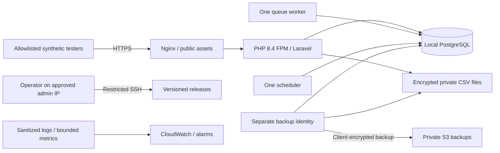

# Engineering quality command contract

EQ-01 separates dependency installation, application initialization, and quality
checks. CI never calls `composer setup`, runs Artisan migrations directly, writes
an environment file, or clears development configuration caches.

For the current reusable standards and review entrypoints, start with
[engineering/README.md](engineering/README.md). The
[adaptation guide](engineering/ADAPTING.md) separates portable controls from
IntelLedger's domain/hosting choices, and the
[walkthrough syllabus](engineering/WALKTHROUGH.md) prepares the final educational
sessions. This document retains detailed implementation and incident evidence.

The [EQ-11B final evidence report](engineering/VALIDATION.md) supersedes historical
open-status summaries below: it distinguishes fresh local checks, inspected older
hosted runs, actual repository settings, explicit skill trials and remaining
deferrals. In particular, the workspace secret aggregate still refuses missing
Git history; a separately scanned remote mirror is not its replacement.

## Commands

Run these from the repository root after installing the locked dependencies.

| Command                      | Contract                                                                                             |
| ---------------------------- | ---------------------------------------------------------------------------------------------------- |
| `composer ci:check`          | Run backend quality, frontend quality, and isolated tests serially.                                  |
| `composer ci:browser`        | Explicitly run `ci:check` followed by the independent browser accessibility checks.                  |
| `composer quality:browser`   | Run synthetic Playwright/axe checks and their failure probes; requires Chromium, Firefox and WebKit. |
| `composer quality:backend`   | Global PHPStan/Larastan level 8, scoped Rector dry-run, then Pint check mode.                        |
| `composer rector:check`      | Check the reviewed modernization rules across DTOs/enums without rewriting source.                   |
| `composer security:check`    | Audit both lockfiles against live advisory services; vulnerabilities and scan errors fail.           |
| `composer security:composer` | Audit all locked PHP packages; abandoned packages produce maintenance warnings.                      |
| `composer security:npm`      | Audit all locked npm dependency types; every reported vulnerability severity blocks.                 |
| `composer quality:frontend`  | Production build, TypeScript, native Node utility tests, then Vite Plus lint/format checks.          |
| `composer test:isolation`    | Configuration-only isolation regression tests.                                                       |
| `composer test:isolated`     | Isolation regressions followed by the complete serial Pest suite.                                    |
| `composer test`              | Alias for isolated tests; does not initialize the application.                                       |
| `composer frontend:build`    | Build assets and generate ignored Wayfinder files in the isolated context.                           |

The existing `lint:check` and `types:check` aliases remain available. Frontend
phases also expose `frontend:types`, `frontend:test`, and `frontend:check`.
`npm run check` runs Vite Plus lint and formatting **checks** serially and uses
the existing `vite.config.ts`. `npm run test:unit` discovers the existing utility
tests and limits Node's test-file concurrency to one.

Each public check establishes a process-only testing environment through
`Tests\Support\QualityEnvironment`. It generates an ephemeral application key,
selects SQLite `:memory:`, disables persistent sessions/cache/mail/telemetry, and
uses testing-specific framework cache paths. The helper loads configuration only
and calls the unchanged `Tests\TestCase::ensureSafeTestDatabase` before tools can
boot application providers. Database resolution is forbidden in that preflight.
Unsafe cached testing configuration causes failure; it is never deleted or
rewritten to make a check pass. Parent shell variables and `.env` remain unchanged.

Pest's existing guard still runs before database-refresh traits. Application tests
may migrate their verified in-memory database; persistent databases are never a
quality-command target. Standalone PostgreSQL probes are outside this contract.

## Installation and CI

CI uses PHP 8.4, Node 24, and npm 12.2.0. Installation uses `composer install
--no-interaction --prefer-dist --no-progress --no-scripts` and `npm ci`. It does
not update dependency versions. Normal development initialization remains an
explicit separate operation.

Nine independent jobs check backend quality, frontend quality, isolated application
tests, dependency security, source security, secret security, disposable PostgreSQL
integration, browser accessibility and authenticated financial E2E. The test job builds its own assets, so a
frontend formatting failure does not prevent backend tests from running. The
existing `ci` check aggregates every result and fails if any job fails or is
skipped, cancelled, unknown or missing. Pinned Actions, read-only
permissions, and disabled checkout credentials remain in place.

Commands fail fast with a nonzero exit status. If the aggregate stops on an
existing failure, run the remaining phase aliases separately to collect results;
do not disable rules or skip tests. CI also checks `git diff --exit-code HEAD`.
Build products, generated Wayfinder code, tool caches, and test artifacts may be
written to ignored locations; tracked source and development configuration may
not be rewritten. `composer lint` and `npm run check:fix` are deliberately mutating
developer tools and are not part of the CI graph.

PHPStan runs without parallel workers and with a 512 MiB ceiling; Pint uses
check mode without parallelism. Node receives a 512 MiB old-space limit and a
small young generation. Native build/lint workers are bounded, and Pest and Node
test files run serially. Existing frontend severity and strict TypeScript settings
remain enforced. Security, disposable PostgreSQL and browser coverage are separate
mandatory CI jobs; local `ci:check` does not require their tools or database.

## Frontend quality and ownership

`vite.config.ts` is the single Oxlint/Oxfmt policy. All application-owned React,
TypeScript, declarations, and native Node tests under `resources/js` are linted
and formatted. This includes every `components/ui` primitive: copied shadcn
components and Radix wrappers are maintained application source, not vendor code.
Review upstream updates under the same checks rather than restoring exemptions.

Oxlint retains its default Unicorn, TypeScript, and Oxc plugins and adds native
React correctness rules. `react/rules-of-hooks` and `react/exhaustive-deps` are
explicit errors; warnings also fail checks. Type-aware linting and the existing
`tsc --noEmit` configuration (`strict`, `noImplicitAny`, `isolatedModules`) remain
enabled. Do not add duplicate ESLint/Prettier configurations or bypass checks
with file-wide or inline suppressions.

The EQ-09B1 Playwright configuration and `tests/Browser` TypeScript/TSX fixtures
are also included in strict TypeScript analysis and the existing lint/format
checks. Isolated test infrastructure is application-owned source, not an exclusion.

The only explicit lint exclusions are:

| Paths                                                                            | Reason                                                                                           |
| -------------------------------------------------------------------------------- | ------------------------------------------------------------------------------------------------ |
| `vendor/**`, `node_modules/**`                                                   | Dependencies maintained by their upstream packages.                                              |
| `public/build/**`, `bootstrap/ssr/**`                                            | Generated production bundles; check their source instead.                                        |
| `resources/js/actions/**`, `resources/js/routes/**`, `resources/js/wayfinder/**` | Wayfinder-generated bindings; regenerated by the isolated build and still checked by TypeScript. |

Oxfmt has no application-source exclusions. Its normal `.gitignore` handling
omits dependency directories and generated artifacts, including the paths above.
Repository YAML and Composer metadata are also formatted. The obsolete
`tailwind.config.js` and mail-template exclusion patterns have been removed.
Any future exclusion must identify its generator or external maintainer.

Use `composer frontend:check` for non-mutating lint/format checks and
`composer frontend:types` for TypeScript. When authoring, run `vp fmt <changed
paths> --write --threads=1` only on intended files. Existing quote, indentation,
semicolon, import, and Tailwind class sorting conventions apply consistently.
Never use repository-wide write mode merely to make CI green.

Native Node contract tests verify lint discovery covers application modules,
React/Hooks enforcement stays active, and deliberately invalid temporary UI
fixtures fail both lint and formatting without being rewritten. Fixtures are
removed in `finally`; these tests run serially through the existing
`composer ci:check` utility-test phase. Component interaction, keyboard/focus,
contrast and browser accessibility are covered by the separate EQ-09 harnesses.
Manual screen-reader and broader visual/assistive-technology verification remain
open; see the current standards index.

## PHP type-safety standard

PHPStan/Larastan level 8 and the selective Strict Rules described in EQ-03C are
mandatory globally in `phpstan.neon`. Run
`composer types:check` to analyse every configured path: `app/`,
`bootstrap/app.php`, `config/`, `database/`, and `routes/`. The command retains
the isolated environment, serial analysis, and 512 MiB limit. It is included once
in `quality:backend`, and therefore `ci:check` and the existing backend CI job.
The redundant `types:check:pilot` alias has been removed; no caller-maintained
path list or separate lower-level gate remains. No baseline, suppressions, or
reduced rules have been introduced.

Use `composer types:check -- -v --error-format=json` for machine-readable full-app
diagnostics. Level 8 adds nullable access checks; passing it does not prove that
arbitrary `mixed` input is safe. The sections below record the historical bounded
migration from level 7 to global level 8, completed in EQ-03B8. References to pilot
commands and outstanding findings in those entries describe their state at that
milestone, not additional commands or current exceptions.

The initial EQ-03A assessment found 67 diagnostics:

| Cause                                                                             | Initial | Remaining after pilot |
| --------------------------------------------------------------------------------- | ------- | --------------------- |
| Framework-authenticated `Request::user()` remains nullable in its public contract | 48      | 48                    |
| Nullable timestamp accessors and Carbon's `toISOString(): ?string` contract       | 13      | 8                     |
| Nullable team/owner relationships and collection lookups                          | 5       | 5                     |
| Import result array contains a nullable `fresh()` model                           | 1       | 1                     |
| Newly reported missing declarations                                               | 0       | 0                     |

The five pilot diagnostics are resolved by checking ISO results and stored FX
timestamps before constructing typed output. Invalid timestamps fail explicitly;
there is no empty-string fallback or assertion overriding an inferred type.
Broad DTO serialization annotations were also replaced by exact array shapes
and explicit fields. Decimal strings, half-even rounding, identity conversions,
authorization, account selection, and transaction boundaries remain unchanged.

EQ-03A left 62 diagnostics to review, not presumed production
bugs. Authenticated middleware explains many request-user findings but does not
narrow PHP's public method contract. Potential null dereferences in owner lookup,
fallback teams, timestamp hydration, and import refresh paths needed focused
precondition/error-path review, now completed through EQ-03B8. Do not replace relationships with a fabricated
non-null PHPDoc type or append casts to silence these findings.

### Strict PHP convention

New application-owned PHP files must place `declare(strict_types=1);` immediately
after `<?php`, use native parameter/property/return types, and describe structured
arrays with PHPDoc shapes. EQ-03A introduced this in two FX DTOs and their two
Action call sites. EQ-03D extends the bounded valuation scope and adds a Pest
architecture check; existing files elsewhere migrate only after caller and
regression review. The check intentionally does not reject every historical file.

Inspect outgoing calls and return values before adding the declaration. Strict
scalar argument checking is controlled by the calling file; adding it only to a
DTO does not stop weak callers from coercing numeric input. Return enforcement
also becomes strict in the declaring file. Framework callbacks or container
invocation may still originate in weak framework code. Explicit input validation
remains necessary: FX amount entry points intentionally accept `mixed` and reject
non-strings themselves, preserving their decimal-only contract for weak callers.

Framework overrides and contracts must preserve compatible signatures, nullability,
and variance. Keep broad input at genuine request/hydration boundaries and narrow
it before calling domain code. PHP has no native `resource` parameter type; use
`@param resource` plus runtime stream validation, never a class named `resource`.
Generated/vendor files are not strict-type migration targets. Any deliberate weak
integration boundary needs an explicit reason and tests, rather than a blanket
exception for controllers, models, factories, or tests.

### PHP runtime support

The root requirement and lockfile now declare `php: ~8.4.1`, meaning PHP 8.4.1 or
later within the 8.4 minor line, excluding PHP 8.5. Laravel 13.39.0 itself permits
`^8.3`, but locked production Symfony 8.1 components require `>=8.4.1`; Pest 5
requires `^8.4`, and PHPUnit 13.4 requires `>=8.4.1`. Application code also calls
the native PHP 8.4 `array_all` function. The full locked application therefore
cannot run on PHP 8.3, including when development dependencies are omitted.

The dependency-derived minimum is 8.4.1. Local validation runs on PHP 8.4.2; the
existing CI jobs select PHP 8.4. Neither the exact 8.4.1 patch nor PHP 8.5 has been
executed in this environment. The declaration is a supported-minor policy, not a
claim that every patch has been exercised. Use a maintained 8.4 patch in
deployment; require a separate compatibility run and CI decision before widening
the minor range. `^8.4` would also admit 8.5 and is intentionally not used. See
[Composer's tilde constraints](https://getcomposer.org/doc/articles/versions.md#tilde-version-range-).

The EQ-03D refresh used `composer update --lock --no-install --no-scripts` and
changed only the lockfile content hash and platform requirement. Package versions,
references, and all package metadata are unchanged. No dependencies were installed
or upgraded. `composer validate --no-check-publish` and
`composer check-platform-reqs --lock` verify consistency and the actual current
runtime; repeat the latter with `--no-dev` for the production dependency scope.
Do not fake `config.platform.php`, ignore platform requirements, or modify
Composer's generated platform checker. Its existing 8.4.1 floor remains valid;
the supported upper bound is enforced by Composer's root constraint at dependency
resolution/installation, not by a newly invented application bootstrap guard.

The original EQ-03A plan was to resolve nullable boundaries before raising the
global level. That migration completed in EQ-03B8; selective Strict Rules followed
in EQ-03C. The entries below retain the history of those bounded batches. Rector
remains a separate task.

### EQ-03B1: category authentication boundary

The authenticated-user findings originate in 15 controllers (47 diagnostics) and
`ProfileUpdateRequest` (one diagnostic). Category management is the first bounded
workflow: its controller contributed three findings when handing
`Request::user(): User|null` to save/archive Actions requiring `App\Models\User`.
Route middleware authenticates the request at runtime, but does not narrow the
public request method's static contract.

`TransactionCategoryController` now uses a private `authenticatedUser(Request):
User` method for its three mutation handoffs. It reads the request resolver once,
checks `instanceof App\Models\User`, and otherwise throws Laravel's
`AuthenticationException`. It never substitutes the globally authenticated user,
another principal with the same ID, or a user inferred from Team membership.
The helper is local because only these three call sites have been migrated;
there is no new base request, controller hierarchy, or global `user()` override.

The existing `auth`, `verified`, and `EnsureTeamMembership` middleware, scoped
bindings, Form Request policy checks, and Action-level `Gate::forUser` checks are
unchanged. Authentication failure still uses the application's configured Laravel
exception handling: browser guests go to login and JSON guests receive 401.
Membership and policy denials remain 403; foreign category bindings remain 404.
Role permissions, validation feedback, redirects, JSON creation responses, and
Inertia page props retain their existing behavior.

The level 8 pilot additionally analyses the category controller, list/save/archive
Form Requests, save/archive Actions, category policy, category validation trait,
and financial authorization trait. Only the controller needed a production change.
Security tests cover owner/admin success with a different current-Team preference,
guest browser/JSON mutations, JSON guest listing, outsider attempts, and missing
or non-application request principals even while the global guard holds a valid
owner. A resolved member is also denied by the Action despite a privileged global
guard. Existing member-permission, cross-Team binding, parent-reference, and
history-preservation tests remain part of focused validation.

After EQ-03B1, full-app level 8 has 59 diagnostics: 45 authenticated-user contracts,
eight timestamp contracts, five nullable relationship/lookup findings, and one
import-result shape finding. The global level remains 7. Timestamp, relationship,
import, and calculation code are deliberately unchanged in this batch. Payee
management is a suitable next authentication batch: its three mutation handoffs
have the same boundary shape and existing security coverage.

### EQ-03B2: payee authentication boundary

Payee management uses the same private `authenticatedUser(Request): User` method
as category management. Its create/update/archive handoffs accept only the
request's `App\Models\User`; missing or incompatible principals throw Laravel's
`AuthenticationException`, even when the global guard holds a valid owner.
The list route retains its existing middleware and Form Request authorization.
Routes, policy permissions, Action-level actor authorization, scoped bindings,
validation, JSON creation responses, redirects, and Inertia props are unchanged.

The level 8 pilot now covers 20 files, adding the payee controller, three Form
Requests, two Actions, and policy. The new security tests exercise owner/admin
success in an explicit household despite another active preference, browser/JSON
guest failures, outsider denials, missing/incompatible request principals, and
the resolved member's denial despite a privileged global guard. Existing catalog
tests cover member read-only access, cross-Team bindings, duplicate payee names,
and historical-reference preservation.

The two local principal methods are intentionally identical. A shared resolver
could centralize this narrow authentication contract during a later rollout,
but two short methods do not yet justify a new abstraction. Any future resolver
must accept the request, return only its application User or throw, and leave
Team and policy decisions at their existing boundaries. Do not override `user()`
globally or substitute another principal.

After EQ-03B2, exploratory full-app level 8 has 56 diagnostics: 42 authenticated-user
contracts, eight timestamp contracts, five nullable relationship/lookup findings,
and one import-result shape finding. Global enforcement remains level 7; the
expanded pilot remains part of the unchanged `composer ci:check` contract.

### EQ-03B3: shared authenticated-principal contract

`App\Http\AuthenticatedUserResolver::resolve(Request): User` is the shared HTTP
principal boundary. It reads the explicit request's user once, validates that it
is an application `User`, and otherwise throws Laravel's
`AuthenticationException`. It is stateless, performs no queries, and has no
guard fallback or Team/permission logic. A concrete class in the existing HTTP
directory keeps it independently testable without a trait, interface, global
request override, or service-provider binding.

Category and payee controllers now constructor-inject this resolver in place of
their private duplicate methods; their existing security tests are unchanged.
The same contract now protects balance recording/voiding, recorded-activity
reporting, and reporting-currency updates. These three additional controllers
previously contributed four nullable actor handoffs. Their middleware, Form
Requests, policy decisions, Action-level actor authorization, responses, and
financial calculations are unchanged. The resolver validates identity only;
authorization still belongs at those existing boundaries.

The level 8 pilot covers 40 files, including the resolver and the three added
workflows' controllers, Requests, Actions, policies, validation rules, and
activity DTOs. New resolver tests cover identity, one-time resolution, rejected
principals, and reuse without retaining another request's user. New financial
security tests exercise guest JSON responses, wrong principals despite a
privileged global guard, denied outsider/member principals, and balance actor
metadata when the guard belongs to an unrelated user. Existing HTTP regression
tests retain owner/admin success, member read access, tenant binding, historical
data, and browser/Inertia response coverage.

Full-app level 8 now has 52 diagnostics: 38 authenticated-user contracts, eight
timestamp contracts, five nullable relationship/lookup findings, and one
import-result shape finding. Global enforcement remains level 7. The shared
resolver permits further bounded controller migrations; Team invitation handling
is a suitable next workflow. Transaction and transfer controllers also have
unrelated timestamp findings that need separate explicit treatment before those
entire controllers can join the passing level 8 pilot.

### EQ-03B4: invitation authentication boundaries

`TeamInvitationController` constructor-injects the shared principal resolver for
creation, revocation, acceptance, and decline. Creation/revocation now pass that
resolved user to the same existing policy abilities with `Gate::forUser`, so an
unrelated global guard cannot authorize the request actor. Creation records that
same actor in `invited_by`. Three nullable-user diagnostics are resolved.

`RespondToTeamInvitationRequest` resolves its application principal before
constructing `ValidTeamInvitation`. Laravel injects the resolver into `rules()`;
this preserves the framework's Request constructor and initialization contract.
Without this check, an incompatible principal could trigger a rule-constructor
type error before the controller's authentication check. The rule itself and its
case-insensitive email, pending/accepted, and expiry semantics are unchanged.

No invitation lifecycle Action exists to migrate: the existing controller retains
its Team/invitation locks, transaction retries, locked eligibility revalidation,
owner-role rejection, and `firstOrCreate` membership behavior. Decline/revocation
retain their existing deletion lifecycle. Policy permissions, middleware,
validation messages, notification content, and redirects remain unchanged.
The added tests exercise request/global-principal disagreement, guest redirects
and JSON errors, incompatible principals at controller and Form Request
boundaries, foreign-Team revocation, replay outcomes, existing member-role
preservation, and eligibility changes after request validation. Existing tests
still cover owner/admin invitations and rejection of legacy owner invitations.
SQLite tests verify observable outcomes, not PostgreSQL lock contention.

There are no signed invitation mutation routes. Notifications link to login with
the invitation's random code; mutation routes require authentication and response
eligibility still requires the matching email and a valid pending invitation.
Login/registration invitation context intentionally remains guest-accessible.
Those Fortify callbacks retain their existing pending-invitation filtering and
limited context response; no principal resolver is forced into them.

The level 8 pilot now covers 49 files, adding the invitation controller, two
Requests, two rules, model, notification, factory, and Fortify provider. Full-app
level 8 has 49 remaining diagnostics: 35 authenticated-user contracts, eight
timestamp contracts, five nullable relationship/lookup findings, and one
import-result shape finding. Global enforcement stays at level 7. The dashboard
controller's two remaining authenticated-user findings are a suitable next
bounded batch, preserving its financial and pending-invitation response contracts.

### EQ-03B5: dashboard, account, import, and profile boundaries

The dashboard and three additional controllers now constructor-inject the same
principal resolver: financial account management, private CSV staging, and
current-user profile settings. These remove ten controller findings; resolving
the principal in `ProfileUpdateRequest::rules()` removes one more. Laravel method
injection preserves the Form Request constructor and uses the request user's ID
for the existing email uniqueness rule.

The dashboard resolves one actor for pending-invitation email filtering, its
shared lazy valuation closure, and permission flags. It applies the same existing
financial `viewAny` policy at entry so a partial Inertia response cannot skip
authorization by omitting financial props. The calculator remains unchanged and
both financial props still reuse one calculation. Existing query-count regression
tests retain one financial-account/balance query and one FX lookup per currency.

Account page policy checks and permission flags use `Gate::forUser` with the
resolved request actor. Create/update still delegate to existing Actions; archive
retains its locked transaction and the same policy. CSV upload delegates to the
unchanged staging Action with the resolved actor. Route Team scoping, validation,
holder/history rules, parser/storage security, and response shapes are unchanged.

Profile settings use the resolved user for self-service reads, updates, and the
existing deletion Action. Password validation, ownership checks, logout, and
session invalidation remain unchanged. Application `User` implements
`MustVerifyEmail`, so the authenticated profile's existing `mustVerifyEmail` prop
remains true under the explicit native-user contract. Unverified users can still
edit their profile; financial dashboards retain the existing verification
requirement. Public welcome and guest login/registration context remain public.

New security tests cover incompatible/missing principals, request/global-user
disagreement, partial dashboard requests, member read-only permissions, denied
outsider/member mutations, profile uniqueness identity, and correct account/import
actor metadata. Existing dashboard, account, CSV, and profile regression suites
remain unchanged, including data isolation and last-owner deletion coverage.

The level 8 pilot now covers 71 files: the completed controller/request boundaries
and their passing supporting contracts. The pre-existing owner lookup findings in
`UpdateFinancialAccount` and nullable refreshed import result in
`UploadTransactionImport` remain outside the passing pilot and inside full-app
analysis; this batch neither suppresses nor changes them. No existing pilot path
is removed. Global analysis stays at level 7.

Full-app level 8 now reports 38 diagnostics: 24 authenticated-user contracts,
eight timestamp contracts, five nullable relationship/lookup findings, and one
import-result shape finding. The remaining authenticated-user findings are in
five controllers, each also containing existing timestamp diagnostics. A suitable
next batch is the exchange-rate controller: explicitly address its two timestamp
contracts and then its single principal handoff, keeping the whole controller
eligible for the passing pilot without ignores.

### EQ-03B6: financial controller principal and timestamp contracts

The remaining financial-controller findings were in FX, transactions, and
transfers. Only two additional financial controllers had principal findings;
the user explicitly kept this batch financial and deferred TeamController.
All three controllers now constructor-inject the existing principal resolver.
Read policies, capability flags, and mutation handoffs consistently use the
resolved request user; the same policy abilities and lifecycle Actions remain
responsible for permission and financial decisions.

Required FX effective/recording timestamps, transaction revision recording times,
and transfer/original-reversal recording times are checked before serialization.
The controllers use the existing nullable Carbon accessors and `toISOString()`
results, then throw a generic `UnexpectedValueException` if a required value is
null or invalid. They never substitute today's date or emit a fabricated date.
Valid dates retain the same UTC ISO strings and six fractional digits. Absent
reversal groups and optional FX metadata remain optional. No schema, model,
calculation, auditing, or lifecycle Action implementation changes were needed.

The new timestamp tests corrupt hydrated test objects through retrieved events,
leaving valid database observations intact. They verify controlled server errors
and the reported exception, unchanged stored history, year-zero/null failures,
and timezone/microsecond preservation. Principal tests cover every controller
entry point, wrong/missing principals, request/global-user disagreement, denied
member/outsider mutations, member read-only capabilities, and creation actors in
audits. Direct handoff tests validate payloads with real Form Request rules;
existing HTTP suites retain full middleware/Form Request authorization coverage.
FX, transaction, reversal, and transfer regression suites remain unchanged.

The level 8 pilot now has 100 distinct paths. It adds the three controllers and
their passing Requests, Actions, policies, timestamp models, and factories;
no existing pilot paths or analysis rules are removed. This batch eliminates
eight authenticated-user and five timestamp findings. Full-app level 8 now has
25 diagnostics: 16 authenticated-user, three timestamp, five relationship/lookup,
and one import-result shape finding. Global enforcement remains level 7.

Two further bounded batches can plausibly clear the remainder:

1. Team/security boundaries: TeamController and SecurityController principal
   contracts (16), their two display timestamps, and the three Team fallback/
   personal-Team lookups across HasTeams, TeamController, and TeamMemberController.
   Preserve last-owner, membership, password, passkey, and 2FA behavior with their
   existing security suites and request/global-principal regression coverage.
2. Financial data contracts: the two UpdateFinancialAccount holder-lookup findings,
   the refreshed UploadTransactionImport result, and AccountTransaction's canonical
   recording timestamp. Verify explicit failures, atomic rollback, import retry
   behavior, and exactly-once audit history. Then run full-app level 8 and CI;
   raise global enforcement only after both are clean, without suppressions.

### EQ-03B7: Team and security contracts

TeamController, TeamMemberController, and SecurityController constructor-inject the
existing authenticated-principal resolver. Team policy checks and capability flags
use the request actor explicitly. This includes an entry `view` check before Team
settings data is read; the existing membership middleware and policy permissions
are unchanged. Member operations keep the actor separate from the target user.
Password changes, passkey listing, and TOTP state display use the resolved request
user; native password rules, password confirmation, throttling, and Fortify's
two-factor state handling remain in place.

`fallbackTeam(?Team $excluding): ?Team` now narrows the optional exclusion with an
explicit `if` before adding the same query filter. No exclusion and no result both
remain valid; alphabetical selection and caller handling of no fallback are
unchanged. `personalTeam(): ?Team` also remains nullable. Where member removal or
Team deletion requires switching another user to their personal Team, a missing
Team now raises a field-specific validation error inside the existing transaction
instead of passing null to `switchTeam`. The transaction rolls back all prior
writes. It never creates a replacement or chooses an unrelated/global user's Team.
No switch is required when removing a member whose current Team is elsewhere.

Existing response types require invitation `created_at` and passkey
`created_at_diff` strings. Their serializers now validate the required creation
timestamps and fail with a generic `UnexpectedValueException` if missing/invalid.
Valid ISO/relative strings are unchanged. Passkey `last_used_at_diff` and
`authenticator` remain nullable. The public passkey-discovery endpoint and guest
welcome/login/registration routes are unchanged; no resolver is forced into them.

New tests cover missing/incompatible principals, request/global-user disagreement,
owner and member permissions, cross-Team/unknown-Team access, required creation
dates, optional passkey metadata, missing-personal-Team rollback, nullable fallback
selection, and successful removal when no personal-Team switch is needed. Existing
Team, membership, invitation, account-deletion, password-confirmation, and TOTP
suites retain their security coverage. No policy, middleware, schema, financial
Action/model, or vendor implementation has changed.

The level 8 pilot now has 119 distinct paths, including the completed controllers,
Team concern/models, Requests, creation Action, DTOs, and unchanged middleware.
This batch removes 16 authenticated-user findings, two display timestamps, and
three nullable Team lookups. Full-app level 8 now reports only four financial
contract findings: two owner-collection lookups in `UpdateFinancialAccount`, one
nullable refreshed batch in `UploadTransactionImport`, and AccountTransaction's
canonical recording timestamp. Global enforcement remains level 7. Complete that
final bounded batch with explicit errors, rollback/import-retry/audit tests; run
full-app level 8 and CI before considering global level 8 enforcement.

### EQ-03B8: Global level 8 enforcement

The final four findings are resolved without changing financial arithmetic,
authorization, schema, or transaction boundaries:

- `UpdateFinancialAccount` validates each required retained-holder lookup before
  filling/saving it. A missing holder raises a field-specific validation error
  inside the existing transaction. Earlier account, institution, and holder edits
  roll back together; no holder is skipped or replaced. The account-scoped
  collection and existing Team/account validation preserve holder identity.
- `AccountTransaction::recorded_at` is legitimately nullable before initial save.
  Its PHPDoc now matches the existing accessor. Canonical audit snapshots require
  a valid timestamp and explicitly reject a missing/invalid UTC ISO value. The
  normal initial-save assignment remains unchanged, as do six-digit microsecond
  precision, immutable recording time, revision ordering, and JSON values. A
  snapshot failure rolls back the movement and revision using the existing auditor.
- `UploadTransactionImport` validates the nullable `fresh()` result before
  returning a successful result. Failure stays inside the staging transaction,
  rolls back its rows, removes the encrypted archive through the existing cleanup
  handler, and returns the existing sanitized file error. It never returns another
  batch as a fallback. Repeated uploads still return the original batch and retain
  approvals, imported outcomes, encrypted source rows, and audit history.

Regression tests inject missing records through real database operations/model
events in the guarded SQLite database. They cover rollback after earlier writes,
clean/idempotent retry, preservation of prior approved/imported outcomes, nullable
unsaved timestamps, invalid audit timestamps, and sequential revisions after retry.
The existing financial suites retain decimal, tenant, timestamp-offset, immutable
field, transfer/reversal, and balance-observation coverage. A quality-contract test
also prevents reverting the global level or restoring a separate pilot path list.

The full configured level 8 analysis now reports zero diagnostics. Global
enforcement is level 8; the former 119-path pilot is redundant and removed. The
three public quality phases, fail-closed SQLite guard, check-only formatters,
bounded memory, and nonzero failure propagation remain unchanged.

The reusable lesson is to narrow nullable values where the domain requires them,
not to assume middleware, prior validation, or an earlier database write proves
their existence forever. Keep valid optionality explicit, validate serialization
results as well as source objects, and test rollback/cleanup at the failure boundary.
Static analysis complements authorization and runtime invariants; it does not
replace either. Strict Rules, Rector, higher PHPStan levels, and runtime-policy
changes remain separate tasks.

### EQ-03C: Selective PHPStan Strict Rules

Installed versions: PHPStan 2.3.3, Larastan 3.13.2, and
`phpstan/phpstan-strict-rules` 2.1.0 on PHP 8.4. Strict Rules 2.1.0 requires
PHPStan `^2.3`, compatible with both the installed analyser and Larastan's
`^2.3.0` requirement. It is a development dependency pinned by the root `2.1`
constraint and lockfile. No existing dependency version changed. Installation
used `--no-scripts` to avoid application initialization and package-update hooks.

`phpstan/extension-installer` is not installed. Larastan, Carbon, and Strict Rules
are loaded explicitly, once each; Strict Rules uses
`vendor/phpstan/phpstan-strict-rules/rules.neon`. Recheck this loading strategy
before adding automatic extension registration. Do not combine automatic loading
and a duplicate manual include. See the [upstream selective-rule documentation](https://github.com/phpstan/phpstan-strict-rules/blob/2.1.0/README.md).

The mandatory rule selection is deliberately small:

| Setting                                 | Value   | Rationale                                                                                                                       |
| --------------------------------------- | ------- | ------------------------------------------------------------------------------------------------------------------------------- |
| `strictRules.allRules`                  | `false` | New package rules do not become mandatory without review.                                                                       |
| `strictRules.strictFunctionCalls`       | `true`  | Require strict flags for `in_array`, `array_search`, searched `array_keys`, and `base64_decode`; avoid implicit value coercion. |
| `strictRules.disallowedLooseComparison` | `true`  | Reject PHP `==`/`!=`; make scalar identity and intentional object-value equality explicit.                                      |

`allRules: false` does **not** restore PHPStan's original configuration defaults.
All additional defaults below were reviewed against PHPStan 2.3.3 and retained;
there are no local overrides hiding their findings:

| Extension defaults                                                                                                                                                                                            | Effect and assessment                                                                                                                                                                                 |
| ------------------------------------------------------------------------------------------------------------------------------------------------------------------------------------------------------------- | ----------------------------------------------------------------------------------------------------------------------------------------------------------------------------------------------------- |
| `polluteScopeWithLoopInitialAssignments`, `polluteScopeWithAlwaysIterableForeach`, `polluteScopeWithBlock`: `false`                                                                                           | Stricter variable scope tracking; no new findings.                                                                                                                                                    |
| `checkDynamicProperties`: `true`                                                                                                                                                                              | Found an undeclared User avatar read. No avatar column/accessor exists; the existing nullable response field is now explicitly null.                                                                  |
| `reportMaybesInMethodSignatures`: `true`                                                                                                                                                                      | Found registration's input PHPDoc narrower than Fortify's interface. The annotation now accurately accepts raw `array<array-key, mixed>`; validation still rejects invalid fields before persistence. |
| `reportMaybesInPropertyPhpDocTypes`: `true`                                                                                                                                                                   | Found Membership's `$table` annotation narrower than Eloquent's writable nullable-string property. The inherited contract is preserved without changing the table value.                              |
| `checkExplicitMixedMissingReturn`, `checkFunctionNameCase`, `checkInternalClassCaseSensitivity`, `reportStaticMethodSignatures`, `reportWrongPhpDocTypeInVarTag`, `checkStrictPrintfPlaceholderTypes`: `true` | Additional return, case, inheritance, PHPDoc, and format-string checks; no new findings.                                                                                                              |
| `reportNonIntStringArrayKey`: `%featureToggles.bleedingEdge%`                                                                                                                                                 | Remains false with the current non-bleeding-edge configuration. The package-installed marker is metadata, not an additional rule.                                                                     |

The first full-scope scan found five diagnostics: one strict function call, one
loose comparison, and the three default-driven findings above. `TeamRole` now
uses strict enum membership; permissions are unchanged. Transaction stale-state
comparison retains the intentional semantics of separately hydrated dates by
comparing their exact `U.u` instant strings. Other cast values use strict identity:
decimals remain strings, enums remain enum cases, and null is distinct from an
empty description. This closes the prior null-to-empty stale-description gap
without changing monetary calculations, locking, revision numbering, or the
immutable-field checks. Date objects must never be replaced with a simple
identity comparison or converted to floating-point timestamps.

Tests cover enum permission sets, mixed registration input rejection, nullable
avatar output, valid rehydrated dates, microsecond drift, null/empty concurrent
metadata, large decimal differences, and audit preservation. The quality-contract
tests assert explicit selective configuration and run a harmless temporary probe
through the installed analyser: the two unsafe patterns must produce their exact
rule identifiers, while strict equivalents must pass. The probe establishes the
existing configuration-only isolation preflight before Larastan boots, runs with
256 MiB and bounded time, fixes only Pao's output presentation to standard JSON,
and cleans up its temporary file/directory. It does not touch financial data.

All configured application paths remain analysed at level 8. No Composer quality
alias or CI workflow changes are needed: `types:check`, `quality:backend`, and
`ci:check` already load this configuration and propagate failures. No baseline,
suppression, database configuration change, or test-isolation exception is used.

The other extension rules remain deferred, including boolean-only conditions,
`empty`/short-ternary bans, cast and numeric-operand checks, loop-variable rules,
dynamic-call restrictions, parent-constructor requirements, and strict array
filtering. A sensible next small assessment is `disallowedBacktick` plus
`strictArrayFilter`; then review case-safe static calls separately. For every
expansion, inspect the locked package's defaults, classify the full-scope findings,
and add regression coverage for intended value semantics before enabling a rule.
Do not rewrite framework callbacks, monetary comparisons, or optional-value logic
merely to make a stricter preference pass. Reassess defaults after dependency
upgrades even when `allRules` remains false. Rector remains a separate task.

An additional pre-existing registration edge case was found during regression
design: Fortify 1.41.0 lowercases an array-valued email before calling
`CreateNewUser`, raising a TypeError/HTTP 500. The corrected Action contract is
tested directly with mixed field values; the upstream HTTP normalization path
required a separate bounded input-validation fix, now completed in EQ-06A below.
No registration pipeline or Fortify configuration was changed in EQ-03C.

### EQ-03D: Controlled strict-type adoption

The selected valuation family now declares strict types in four additional DTOs
(`AccountNetWorthContribution`, `CurrencyNetWorth`, `NetWorthResult`, and
`ConsolidatedNetWorthResult`), two enums (`FinancialAccountType` and
`AccountBalanceSource`), and the `NetWorthCalculator` caller. No financial method
body or signature changed. The FX calculator/service were already strict.
`NetWorthCalculatorTest` and `FinancialAccountTypeTest` now also use strict calls;
the consolidation and FX regression tests already did.

Coverage under `app/` increases from 5/161 files to 12/161. The native Pest
`toUseStrictTypes()` architecture expectation protects an explicit 11-class
financial scope: the six valuation/FX DTOs, two enums, and three calculator/service
callers. This includes the four already-strict FX files as well as the seven newly
migrated files. The independently strict authenticated-user resolver is unchanged.
The remaining 149 application files are not silently classified as compliant and
are not rejected by this bounded architecture rule. No new tool or CI alias is
needed: the architecture test is part of the existing serial Pest phase in
`composer ci:check`.

Before adding each declaration, constructor arguments, outgoing calls, returns,
enum conversions, Eloquent casts, and JSON serialization were reviewed. Amounts
passed from account/balance models are decimal strings; raw balance values retain
the existing explicit string check. DTO identifiers are integers, dates are
strings, optional metadata remains nullable, and enum arguments remain enum cases.
The transfer Action/model and recorded-activity calculator were also reviewed as
unchanged external callers of the account-type enum: they already pass strings
through explicit conversion or validation. Their declarations are deferred rather
than expanding this batch into transaction persistence.

Strict typing is a caller-file rule for scalar arguments, not a global runtime
mode or deep validation of arrays. Declaring a DTO strict does not stop weak
callers, reflection/container invocation, or internal-function callbacks from
coercing scalar values. Return checking follows the declaring file. PHP still
permits integers for float parameters even with strict types; monetary contracts
must remain decimal strings and use `brick/math`. JSON encoding preserves these
strings, including negative and very large values; it does not calculate money.
See the [PHP strict-typing manual](https://www.php.net/manual/en/language.types.declarations.php#language.types.declarations.strict).

The new tests reject numeric/boolean monetary arguments at strict call sites and
exercise the DTO/enum JSON contracts with large signed decimals, UTC microseconds,
nullable institution metadata, and empty object maps. Existing valuation, FX,
recorded-activity, and transfer regressions cover valid results, missing balances,
negative liabilities, authorization, and unchanged observation history. These
checks complement the mandatory PHPStan level 8 and selective Strict Rules; none
has been disabled or replaced.

For each future cohort, inspect callers and framework contracts first, make valid
inputs explicit, add strict declarations to the cohesive domain and necessary
call sites, add affected classes to the architecture expectation, and run focused
regressions plus the full CI contract. Do not apply the strict architecture preset
to all of `App` while historical files remain unreviewed. New classes in a migrated
domain should join its check; adopting a new domain requires an explicit scope
decision instead of a large legacy-file allowlist.

Framework integrations must retain inherited parameter/return types, nullability,
and broad raw-input contracts where appropriate. Narrow input with existing
validation before calling typed domain code. A framework or weak-caller boundary
is not a blanket exception for a whole layer: document the specific coercion or
signature requirement, test it, and migrate independently. Vendor/generated code
remains outside application-owned migration scope, and resource parameters stay
PHPDoc `resource` with runtime checks. Never invent unsafe casts to make strict
calls pass.

The separately tracked Fortify malformed-email HTTP 500 was unchanged in EQ-03D. Adding
strict declarations cannot validate an array-valued email before upstream
lowercasing; that boundary required a targeted input-validation fix. PHP 8.5 execution,
additional minor-version CI coverage, broader strict cohorts, and Rector remain
separate work. EQ-06A below subsequently fixes the registration boundary.

### EQ-04: Architectural dependencies and precision checks

Pest 5.3.4 and the already-installed Architecture plugin 5.0.0 now enforce the
existing dependency direction. This is a modular Laravel application, not a new
Clean Architecture directory scheme. Controllers still query lists, authorize
explicit actors/Teams, coordinate Form Requests and Actions, and present Inertia
responses. Financial Actions own lifecycle operations and may use models,
transactions, policies/Gate, shared validation rules, and framework utilities.
DTOs expose data and may use enums, other DTOs, JSON interfaces, and `brick/math`.

| Scope                          | Forbidden direct dependencies                                                                                                                                   | Reason                                                                                                                                           |
| ------------------------------ | --------------------------------------------------------------------------------------------------------------------------------------------------------------- | ------------------------------------------------------------------------------------------------------------------------------------------------ |
| `App\\Data`                    | Application/framework controllers, application Form Requests, framework `FormRequest`, Inertia, `App\\Models`, `Illuminate\\Database`, DB and Schema facades    | Keep DTOs independent of request processing and persistence. The same boundary naturally covers the two household DTOs alongside financial DTOs. |
| `App\\Actions\\Finance`        | Application/framework controllers, application/framework Form Requests, Inertia                                                                                 | Reusable financial operations must not call back into presentation or depend on a request-validation object.                                     |
| `App\\Models`, `App\\Policies` | Application/framework controllers                                                                                                                               | Persistence and authorization must not depend on route handlers.                                                                                 |
| Application classes            | `dd`, `dump`, `var_dump`, `print_r`, `die`, `exit`, `eval`, and direct PHP process functions (`exec`, `shell_exec`, `system`, `passthru`, `popen`, `proc_open`) | Avoid accidental disclosure, unstructured termination, code evaluation, and direct command execution.                                            |
| All application PHP source     | Backtick shell expressions                                                                                                                                      | Check the AST explicitly, including code outside class methods; do not assume a function-call rule detects backticks.                            |

There are no class/file exclusions. The denial of Form Requests is deliberately
specific: `Illuminate\\Http\\UploadedFile` remains a legitimate input to the
staging Action. Actions may use Eloquent, DB, Gate, storage, encryption, and
Laravel Validator. DTO enums and decimal-library dependencies remain allowed.
Framework/vendor implementations and test fixtures are not application-layer
targets. Controller-to-model listing queries and the existing model-level auditor
are preserved; these tests do not invent a repository layer or move business code.

`tests/Support/ArchitectureRules.php` holds the small shared policy used by the
real-source tests and isolated failure probes. `tests/Unit/ArchitectureTest.php`
uses the native Pest Architecture expectations. The existing 11-class financial
strict-type architecture test in `StrictTypeContractsTest.php` is unchanged and
remains mandatory; no all-`App` strict-type requirement is introduced.

#### Targeted financial precision guard

The core areas `Actions/Finance`, `Data`, `Enums`, `Models`, `Concerns`, and `Rules`
are parsed with the already-installed `nikic/php-parser` 5.9.0. The guard rejects
native float/double casts, float literals (including scientific notation), native
division and division assignment, and named calls to `floatval` or `fdiv`.
Name resolution catches qualified and imported/aliased conversion functions.
Native division is prohibited because its result may be floating point; use
`intdiv` for integer bookkeeping and decimal-library division for money.

This is AST inspection, not a regular-expression search. Quoted decimal strings,
comments, similarly named object methods, integer counters, `intdiv`, and
`BigDecimal` calls are permitted. Parser errors fail the check. The initial
dependency/precision review found no existing rule violations, so no application
code, arithmetic, authorization, schema, or financial history was changed.

The precision guard is intentionally **not** a proof of decimal-safe data flow.
It cannot determine whether arbitrary variables in `+`, `-`, `*`, exponentiation,
or compound assignments hold money, catch integer overflow that becomes a float,
or follow dynamic function names, container strings, reflection, arbitrary helper
returns, or Eloquent's string-configured float casts. It also does not scan
presentation code where chart-coordinate numbers can be legitimate. Decimal
input checks, exact casts, PHPStan, and financial regression tests remain required.
A future money-aware static rule would need type/data-flow knowledge, not a
broader regex or a blanket ban on integer arithmetic.

#### Failure probes and execution

`tests/Unit/ArchitectureRulesTest.php` writes syntactically valid but forbidden
class fixtures into a unique OS temporary directory. A fresh, serial Pest child
process registers an in-memory PSR-4 prefix before dependency discovery and calls
the same shared policy. Fixture methods are never invoked. The child keeps the
repository's PHPUnit configuration, explicitly opts external tests into the
installed Architecture trait, and establishes `QualityEnvironment`'s
configuration-only SQLite preflight before launching Pest. It uses 256 MiB and
bounded time; Pao is disabled only for deterministic output presentation.

Seventeen child cases verify DTO-to-controller/request/model/database violations,
Action-to-presentation violations, model/policy-to-controller violations, unsafe
debug/eval/process/exit usage, a missing strict declaration, and allowed
enum/decimal/upload/model integrations. The parent checks exit status, the JUnit
case count, and zero child failures/errors, preventing empty discovery from
appearing successful. These 17 child cases are additional to the outer suite's
reported test count. Files and directories are removed explicitly in `finally`;
no invalid code is written into the repository or left behind.

Additional in-process probes exercise each rejected float construct, an aliased
conversion, shell syntax, harmless comments/strings/integer/decimal examples,
and malformed source. No probe executes a dangerous expression or mutates a
financial record.

Run `composer test:isolation -- tests/Unit/ArchitectureTest.php
tests/Unit/ArchitectureRulesTest.php tests/Unit/StrictTypeContractsTest.php` for the
bounded checks. The normal `composer ci:check` Pest phase discovers them without
new scripts or workflow changes. Configuration-only isolation, PHPStan level 8,
selective Strict Rules, runtime constraints, and check-only formatting retain
their existing contract.

These rules inspect statically discoverable direct dependencies and explicit
syntax. They do not prove transitive purity, authorization, Team isolation,
runtime service resolution, SQL correctness, or financial completeness. New
domains must use the existing namespace conventions to join the corresponding
checks; renamed/moved domains require an explicit policy update. There are no
suppression annotations or broad ignored areas added to obtain a pass. The
separately tracked Fortify malformed-email defect was unchanged in EQ-04; EQ-06A
below subsequently fixes registration. Broader strict typing remains separate.

### EQ-05: Conservative Rector modernization

Rector 2.8.1 is an exact, development-only dependency. It supports PHP 8.4 and
requires PHPStan `^2.3.2`, compatible with the installed PHPStan 2.3.3 and Larastan
3.13.2. The installation added only Rector; no existing locked package was
upgraded or removed. Composer application scripts were disabled during installation.
Review Rector version changes explicitly, including changes to rule implementations.

`rector.php` covers all 11 DTO files in `app/Data` and all 11 enums in `app/Enums`.
There are no exclusions within that scope. Models, Actions, controllers, tests,
migrations, generated files, and vendor code are not rewrite targets. The target
PHP version is resolved explicitly from the root Composer requirement (`~8.4.1`)
using the installed Rector Composer-version resolver, failing if no requirement
can be resolved. No PHP upgrade sets are enabled by selecting that target.

The reviewed rule allowlist is deliberately small:

| Rule                                       | Approved purpose                                                   | Review considerations                                                                                                                                                   |
| ------------------------------------------ | ------------------------------------------------------------------ | ----------------------------------------------------------------------------------------------------------------------------------------------------------------------- |
| `ClassOnObjectRector`                      | Replace `get_class($object)` with `$object::class`.                | Validate that the input really is an object. Do not assume equivalent exceptions for invalid inputs; inspect no-argument calls and scope-sensitive behavior separately. |
| `VariableInStringInterpolationFixerRector` | Replace deprecated `${variable}` interpolation with `{$variable}`. | Preserve the exact output, escaping, array access, and variable-variable semantics; review each actual diff.                                                            |

The initial dry-run proposed **zero transformations** across the 22 files, so no
application change was accepted or needed for this baseline. These rules do not
change decimal strings, arithmetic, DTO shapes, enum values, strict declarations,
or authorization. A clean initial run is not evidence that every future proposal
is safe: the gate requires review, not automatic acceptance.

No broad prepared, upgrade, framework, dead-code, type-declaration, finalization,
readonly, or signature sets are enabled. Import rewriting and unused-import
removal remain disabled. Rector internals also register `RenameClassRector`
without a rename map. It is
explicitly disabled so the only effective transformation rules are the two above;
there are no path exclusions. A configuration regression checks the actual loaded
and disabled rule lists, catching unexpected rules after a dependency change.
The inspected `AddOverrideAttributeToOverriddenMethodsRector` is deprecated and throws in this
Rector release, so it is not enabled. Null coercion, comparison rewrites, property
promotion/hooks, first-class callable conversion, and other potentially semantic
transformations are deferred for separately reviewed cohorts. Do not enable a
large set and then add blanket skips to establish a passing baseline.

Run `composer rector:check` from the repository root. It runs the existing
configuration-only `ci:environment` preflight, then Rector `process` with the
explicit root config, `--dry-run`, and a 512 MiB limit at both PHP and Rector
levels. `withoutParallel()` disables worker fan-out on Windows and GitHub Actions.
The Composer command performs no Laravel application initialization or migrations.
Rector may write disposable caches under the already ignored
`.phpunit.cache/rector` and OS temporary container caches; it does not rewrite
source in dry-run mode. It does not load Larastan's application bootstrap or the
root PHPStan extensions. Standalone PHPStan remains the type-analysis authority.

`quality:backend` runs PHPStan, Rector, then Pint check mode serially. The same
alias is already used by the backend GitHub Actions job and `composer ci:check`;
no workflow duplication is needed. A required transformation returns exit code 2,
and Composer propagates that failure; tool errors are failures too. There is no
automatic write-mode Composer alias. Pint remains the sole PHP formatter.

For a proposed modernization, inspect the complete dry-run diff and relevant
callers first. Apply only specifically approved edits manually or to an explicitly
named, reviewed file list; never run automatic Rector rewrites across `app`.
Exercise changed semantics through focused regression tests, run Pint on the
changed files, then run Rector, PHPStan, architecture tests, and `composer ci:check`.
Review source diffs after validation. Scope/rule expansion requires the same
review, a clean baseline, and focused regression coverage before joining CI.

`RectorContractTest` creates a harmless fixture outside the repository, runs the
actual `composer rector:check` command against it, verifies both enabled rules
are reported with exit code 2, and checks its SHA-256 is unchanged. It then supplies
the modern equivalent and verifies exit code 0 and another unchanged hash. Each
child is bounded to 120 seconds and inherits the isolated environment; the fixture
is explicitly removed in `finally`. The quality-command graph regression also
requires every reachable Rector invocation to retain dry-run mode and the memory
bound. No failing or invalid fixture is left in the application tree.

Rector is a modernization assistant, not a formatter, security proof, decimal
precision checker, or substitute for domain tests. This initial scope intentionally
does not modernize framework integration boundaries. The separately tracked
Fortify malformed-email defect was unchanged in EQ-05; see EQ-06A below.

### EQ-06A: Registration input before normalization

The HTTP regression reproduced a 500 with an array-valued registration email.
Fortify 1.41.0's `RegisteredUserController::store()` calls
`Str::lower($request->{Fortify::username()})` before invoking `CreatesNewUsers`.
`Str::lower()` forwards that array to `mb_strtolower()`, causing a `TypeError`.
The existing `CreateNewUser` validation is correct but cannot protect code that
runs before it. Strict types or a narrower Action PHPDoc cannot fix this boundary.

EQ-06A introduced `ValidateRegistrationEmail` (consolidated into
`ValidateAuthenticationEmail` by EQ-06A2 below) to validate the raw username with
`bail`, `required`, `string`, and `max:255` before the controller runs. The length
limit matches the existing profile/email rule; no email address is coerced from
an array, number, boolean, or object. Laravel's normal `ValidationException`
handling supplies JSON 422 errors or browser redirects with session errors and
password fields excluded from flashed input.

`FortifyServiceProvider` uses Laravel's typed container resolving hook to attach
that middleware only to the installed registration controller's `store` action.
Fortify's route registration, GET view, route-level guest middleware, lowercasing,
post-normalization syntax/uniqueness validation, password rules, transactional
User/personal-Team/owner creation, registration event, verification notification,
guard login, session regeneration, and response contracts remain in place. The
controller is neither replaced nor copied; no vendor file or Fortify configuration
is changed. Guest middleware still redirects an already authenticated user before
the new validation runs. An in-memory compiled-route test verifies that the
container hook also runs through Laravel's compiled route matcher, without writing
a development route cache.

`RegistrationInputTest` covers arrays, nested arrays, JSON objects (decoded by
Laravel into arrays), null, integers, a decimal number, booleans, oversized strings,
and an absent field. Browser/JSON failures preserve empty User, Team, membership,
and invitation tables; malformed input dispatches no registration event or
notification. Valid mixed-case browser and JSON registrations retain lowercased
emails, hashed passwords, personal owner membership, unverified status, one
verification notification, and the existing redirect/201 response. Normalized
duplicates and existing name, email syntax, password, and confirmation failures
remain rejected without partial records.

#### Adjacent findings deferred to targeted fixes

Three temporary HTTP probes ran under the same SQLite in-memory guard, with
exception/notification fakes and explicit fixture cleanup. They confirmed:

| Entry point             | Verified result for an array-valued email | Cause / next step                                                                                                                                                                                                                                                  |
| ----------------------- | ----------------------------------------- | ------------------------------------------------------------------------------------------------------------------------------------------------------------------------------------------------------------------------------------------------------------------ |
| `POST /login`           | HTTP 500, `TypeError`                     | The application's login limiter in `FortifyServiceProvider::configureRateLimiting()` lowercases raw input before Fortify's `LoginRequest` can enforce its required and string rules. Add a separately reviewed boundary that preserves throttling keys and limits. |
| `POST /reset-password`  | HTTP 500, `TypeError`                     | Fortify's `NewPasswordController::store()` lowercases raw input before inline validation. Harden separately while preserving token, password, and reset lifecycle behavior.                                                                                        |
| `POST /forgot-password` | HTTP 422, email validation error          | `SendPasswordResetLinkRequest` validates before controller lowercasing; this specific array-input failure was not reproduced.                                                                                                                                      |

Those probes are diagnostic fixtures outside the repository, not permanent tests
that enforce defective 500 responses. No adjacent endpoint was changed by EQ-06A.
These were tracked authentication input risks at the completion of EQ-06A;
EQ-06A2 below resolves both. Registration's original correction alone must not be
described as global Fortify input hardening.

### EQ-06A2: Login and password-reset email boundaries

Before implementation, two permanent HTTP regressions expected 422 but reproduced
500 from `POST /login` and `POST /reset-password`. Fortify remains locked at
1.41.0. Login's named `throttle:login` middleware executes before controller
middleware and `LoginRequest` validation: the application's rate-limit callback
passed an array to `Str::lower()`. `NewPasswordController::store()` independently
lowercased its raw email before inline validation. Neither failure could be fixed
inside the later credential or password-reset Actions.

The registration middleware is renamed and reused as
`ValidateAuthenticationEmail`, with a single private rule definition:
`bail`, `required`, `string`, `max:255`. Its `hasValidShape()` method performs
non-throwing validation for safe limiter-key selection. Its normal middleware
handler throws Laravel's validation exception. There is no coercion of numbers,
booleans, arrays, or JSON objects into strings, and no duplicated middleware/rule
implementation. The configured username/email field is passed explicitly by the
provider's existing typed controller-resolution hook.

| Boundary                                                | Execution and contract                                                                                                                                                                                |
| ------------------------------------------------------- | ----------------------------------------------------------------------------------------------------------------------------------------------------------------------------------------------------- |
| Registration `store`                                    | Shared validation before Fortify normalization; existing syntax, normalized uniqueness, password, ownership, and verification behavior are retained.                                                  |
| Password login `store`                                  | Limiter safely selects/counts its bucket first, then shared validation runs before Form Request and pipeline normalization. Shape-valid inputs retain Fortify's existing credential-failure behavior. |
| Password-reset `store`                                  | Shared validation of `Fortify::email()` runs before controller normalization, broker/token checks, and reset Action.                                                                                  |
| GET views, passkeys, TOTP challenge, reset-link request | No new email middleware is attached. Existing middleware, requests, and limiters are retained.                                                                                                        |

Validation failures return JSON 422 or the normal browser redirect with field
errors. Password and confirmation values are not flashed. A request already over
its login limit returns the existing HTTP 429 response first; validation must not
be moved ahead of the named throttle. Authenticated users retain guest-route
redirects. Controller hooks work through the in-memory compiled route matcher;
no development route cache was generated or cleared.

#### Throttling contract and residual limits

For shape-valid login inputs, the exact prior lowercased/transliterated username
plus IP key and **five requests per minute** are unchanged, including case sharing
and invalid-password attempts. The key is normalized only after the shared
non-throwing validator confirms a required string of at most 255 characters.
Malformed inputs use the reserved `malformed-email` plus IP bucket, also five per
minute. Changing an invalid value or type does not obtain a new bucket. Laravel
counts attempts before validation throws: the first five malformed requests yield
422 (or browser redirects), and the sixth yields 429 with `Retry-After`.
Separate IPs have separate buckets, and exhausting this bucket does not exhaust
a legitimate email's login bucket. No raw payload, password, or reset token is
included in this fallback key or added to logs.

This deliberately replaces normalization crashes and avoids an unthrottled early
validation exit. It does not add a global login/IP limit for shape-valid usernames;
the existing ability to distribute attempts over usernames/IPs is unchanged.
Malformed requests behind a shared IP share the fallback allowance. Proxy/IP trust
configuration is unchanged. Password-reset submission had no route-level request
throttle and still does not; reset-token generation retains its existing broker
throttle. Additional reset-request/global abuse limits require a separate policy
decision, not a hidden change to this validation fix.

`AuthenticationInputBoundaryTest` covers malformed email types and lengths through
JSON and browser requests, including JSON objects and their form-map equivalents.
It verifies guest state, unchanged stored passwords/remember tokens, unconsumed
valid reset tokens, and no login/reset events or notifications. Coverage also
includes compiled routes, mixed-case login and reset responses, session rotation,
remember-me cookies, 2FA challenges, email-free passkey options, throttle exhaustion
and expiry, expired/invalid/single-use reset tokens, password/confirmation rules,
guest redirects, and unchanged reset-link validation/notification behavior.
Exception fakes suppress diagnostic error logging; production code adds no
authentication-payload logging. Registered routes, vendor code, reset Actions,
security configuration, and database/test-isolation settings are unchanged.

### EQ-06B: Dependency security and maintenance

`composer security:check` runs the two native package-manager audits serially.
Both aliases retain the configuration-only SQLite preflight. Composer uses
`--locked --abandoned=report --no-interaction`, with plugins and scripts disabled
in the audit subprocess. npm uses `--package-lock-only`, explicitly includes
production, development, optional, and peer dependencies, and sets
`--audit-level=info --ignore-scripts --json`. Neither command installs, upgrades, fixes,
or rewrites dependencies. Inherited production-mode npm omissions cannot hide
development packages from this command.

Every reported vulnerability blocks, regardless of severity, dependency depth,
or production/development classification. Composer's advisory, repository-policy,
and transport failures retain their nonzero exits; npm advisory-service failures
also block. There are no audit ignores, severity exclusions, forced fixes,
`continue-on-error`, or success fallbacks. The aggregate is fail-fast: run the
individual ecosystem aliases separately to collect the remaining results after a
failure. An unreachable service, invalid response, or incomplete scan is a scan
failure, never evidence of a clean dependency graph. Rerun after service recovery.
JSON output also avoids npm 12.2.0's human-readable formatter crash on a synthetic
informational-only advisory report. Native JSON reporting and nonzero exit behavior
are tested without raising the severity threshold or changing npm versions.

The existing three-phase `composer ci:check` remains the deterministic local
quality contract. Run **both** it and `composer security:check` before merging.
The new independent `dependency-security` CI job installs the locked Composer
dependencies with application scripts disabled, establishes the isolated context,
and audits both lockfiles. npm does not need an installation for its lockfile audit.
It uses the existing pinned setup Actions, declared PHP/Node/npm versions,
read-only permissions, disabled checkout credentials, a 15-minute timeout, and
the tracked-file mutation check. No external scanner or database service is added.

The final `ci` job requires all four jobs and runs with `if: always()`. Its small
64 MiB PHP gate accepts only an exact `success` for every result. Missing, unknown,
failed, cancelled, and skipped results fail. PHP setup uses the same pinned
Action. The gate's actual embedded code is exercised locally through subprocesses;
GitHub's workflow scheduling and branch protection still need hosted verification.

#### Inventory and live audit baseline: 2026-10-28

Audits used Composer 2.10.3 and npm 12.2.0, including independent production-only
audits and the final all-dependency `security:check`. Every completed scan returned
exit 0: **zero known vulnerability advisories**, zero Composer abandoned packages,
and no npm deprecation notices in the lockfile. Advisory IDs, affected vulnerable
versions, severities, and fixes are therefore not applicable to this baseline.
Initial sandbox network failures were recorded as failed attempts and retried
with authorized network access; they were not counted as clean scans.

| Ecosystem | Locked inventory                                                                    | Direct declarations                                        | Transitive/exposure interpretation                                                                                                                                              |
| --------- | ----------------------------------------------------------------------------------- | ---------------------------------------------------------- | ------------------------------------------------------------------------------------------------------------------------------------------------------------------------------- |
| Composer  | 158 packages: 103 production-reachable, 55 development-only                         | 7 production, 13 development                               | 138 transitive packages. Production paths contain 96 transitive packages; development-only paths contain 42. Shared dependencies are classified as production-reachable.        |
| npm       | 383 resolution entries: 101 marked development-only, 282 shared/production/optional | 34 dependencies, 5 devDependencies, 7 optionalDependencies | Entries include nested versions and platform variants. Optional/peer counts overlap these classifications and must not be added to them. All are included in the blocking scan. |

Manifest classification is not a runtime exposure proof. Several build tools,
TypeScript/type packages, and CSS/Vite tooling are currently in npm `dependencies`;
production-only npm output is not a list of browser-executable code. Review the
actual dependency path, bundled output, SSR/server deployment, and installation/
build execution before assigning exposure. Development dependencies can execute
in developer machines/CI or influence shipped artifacts, so they are never
automatically exempt. This task does not move packages or modify either lockfile.
Audits identify known published advisories, not every exploitable defect.

#### Dependabot and hosted repository settings

The existing weekly grouped GitHub Actions updates and five-day cooldown are
preserved. Composer version checks run Mondays and npm Tuesdays at 09:00
America/New_York, with at most three open **version-update** PRs per ecosystem.
Minor/patch updates are grouped separately for production and development;
major updates remain individual. All updates require review and the normal gates;
there is no automatic merge or blanket ignore policy.

Dependabot security updates are event-driven and do not wait for these version
schedules or their PR limit. GitHub maintains a separate security-update PR limit
(currently ten); the YAML does not change it. Security grouping is not enabled, so
urgent fixes stay individually reviewable. Repository administrators must enable
the dependency graph, Dependabot alerts, and Dependabot security updates, and make
the final `ci` check required in rulesets/branch protection. Verify the first hosted
run, restricted-token PRs, advisory-service access, and initial bot PRs. Configuration
alone cannot prove those settings are enabled. See the official
[Dependabot options reference](https://docs.github.com/en/code-security/reference/supply-chain-security/dependabot-options-reference)
and [security-update configuration](https://docs.github.com/en/code-security/how-tos/secure-your-supply-chain/secure-your-dependencies/configure-security-updates).

#### Triage, remediation, and exceptions

Assign each finding an owner and track its advisory ID/URL, package and exact
locked version, affected range, severity, direct/transitive parent path, runtime/
build/test exposure, fixed release, mitigations, and remediation issue. Confirm
upstream advisory details before changing constraints or overrides. A development
label or absence of a known exploit is not enough to dismiss a vulnerability.
For transitive fixes, prefer the supported parent update; never run audit-fix with
force or add an unreviewed override simply to make a report green.

| Finding                        | Triage target                | Remediation target                            |
| ------------------------------ | ---------------------------- | --------------------------------------------- |
| Critical or actively exploited | Within 4 hours               | Within 24 hours; contain exposure immediately |
| High                           | Within 1 working day         | Within 3 calendar days                        |
| Moderate                       | Within 2 working days        | Within 14 calendar days                       |
| Low/informational advisory     | Within 5 working days        | Within 30 calendar days                       |
| Unknown severity               | Treat as high until assessed | Follow the assessed severity target           |

These are operational response targets, not delayed enforcement: every known
vulnerability already blocks the gate. If no fix exists, assess removing/replacing
the dependency, isolating the exposed functionality, or maintaining a reviewed
patch/fork. Re-run both audits and the full quality contract after a reviewed fix.

An abandoned Composer package is reported using `--abandoned=report`; it does not
become a vulnerability solely because its maintainer changed status. npm's locked
deprecation metadata and upstream archived/EOL/unmaintained notices are likewise
maintenance warnings, not silently ignored. Create an owner-assigned assessment
within seven days, review supported replacements/forks and security-update paths,
and record a migration/retention plan within 30 days. Review maintenance status
manually; a quiet release history alone is not proof of abandonment. A published
advisory always follows the blocking vulnerability policy.

There are **no active exceptions or technical audit bypasses**. A requested
exception must name the advisory and exact dependency scope, explain reachability
and compensating controls, link a remediation issue, name an owner and a separate
security/maintainer approver (the repository owner if no security team exists), and
record approval and expiry dates. Maximum initial approval is seven days for
critical/high risks and 30 days for lower risks; expiry or changed exposure requires
fresh review. Risk acceptance alone does not make a failing scan pass. Any future
advisory-specific suppression requires a separate reviewed implementation with
automated expiry enforcement. Blanket package/severity ignores are prohibited.

Review new alerts on receipt, run/review both scans at least weekly even without
code changes, review any maintenance plans/exceptions weekly, and review this
policy and upstream maintenance status quarterly. The current CI scans on pushes
and PRs, not on a scheduled workflow. Dependabot alerting does not replace this
operational review. Semgrep is introduced below; CodeQL, secret scanning, and PR
dependency-review integrations remain deferred.

#### Failure probes

`DependencySecurityContractTest` parses the actual YAML, checks the dependency
job/gate wiring and Dependabot limits, and executes the final gate code against
successful and unsuccessful result combinations. A temporary loopback advisory
server supplies synthetic Composer/npm reports to the real `composer security:check`
commands in disposable projects. The probes cover clean scans, Composer low and
npm informational/high advisories in development-only packages, abandoned warnings,
and HTTP 503 failures from each advisory service. They verify nonzero propagation
and unchanged fixture lockfiles without accessing public registries, installing
packages, or opening application databases. The localhost server and subprocesses
are time/memory bounded; cleanup validates the resolved temporary directory before
removing it. No synthetic advisory is an actual project finding.
The fixture bootstrap calls the existing isolation guard directly; its native
audit command lines are copied from `composer.json`. Restricted Windows sandboxes
may require process-control permission to terminate the owned server during
cleanup. Run with that permission rather than skipping the probes or weakening
database isolation.

### EQ-06C1: Local-only source security

`composer source:check` runs `source:scan`, then `source:test`. It is a separate
mandatory CI job alongside dependency security and the existing three-phase
`composer ci:check`; the latter's command contract remains unchanged. Run both
security commands and `ci:check` before merging. Every job must succeed for the
final `ci` check to succeed, including cancelled, skipped, or missing job results.
There is no `continue-on-error`, automatic fix, remote analysis, or source artifact.

#### Installation and ownership

Use CPython **3.11** and Semgrep Community Edition **1.182.1**, isolated from the
application and global Python environment. `semgrep-requirements.txt` pins the CLI
and its resolved Python dependencies; the Windows-only dependency has an explicit
platform marker. Composer/npm lockfiles and application dependencies are unchanged.
Pinned versions make resolution reproducible; these requirements are not an
artifact-hash lock or a hermetic operating-system image. Linux installations may
build a pinned dependency when no compatible wheel is available.

Windows PowerShell:

```powershell
py -3.11 -m venv .phpunit.cache/semgrep-venv
.phpunit.cache/semgrep-venv/Scripts/python.exe -m pip install --disable-pip-version-check -r semgrep-requirements.txt
.phpunit.cache/semgrep-venv/Scripts/python.exe -m pip check
composer source:check
```

Linux / GitHub Actions:

```sh
python3.11 -m venv .phpunit.cache/semgrep-venv
.phpunit.cache/semgrep-venv/bin/python -m pip install --disable-pip-version-check -r semgrep-requirements.txt
.phpunit.cache/semgrep-venv/bin/python -m pip check
composer source:check
```

No login or AppSec Platform account is needed. The runner rejects an unexpected
CLI version. Native Windows startup requires access to the Windows certificate
store even for local scanning; a restricted sandbox may require execution
permission. Do not disable TLS checks to work around this. The GitHub job uses
SHA-pinned setup-python, read-only repository permissions, and the same versioned
requirements. Local Windows validation does not prove hosted Linux installation.

The repository maintainers own `semgrep.yml`, its paired probes, the pinned tool
environment, and exclusions. Review upstream releases and rule gaps quarterly and
security advisories when received. Tool/rule updates need a separate reviewed PR,
pin/requirements regeneration in a fresh Python 3.11 environment, positive and safe
fixture results, a complete source scan, and the existing quality gates. Dependabot's
Composer/npm audits do not cover this Python tool environment; Python dependency
vulnerability monitoring is a remaining tooling gap, not a clean security audit.

#### Reviewed rules and scope

These 15 project-authored rules use local configuration, not a changing Registry
pack. All findings block; severity is `ERROR` and is not a CVSS rating.

| Rule group             | Enforced patterns                                                                                                                    |
| ---------------------- | ------------------------------------------------------------------------------------------------------------------------------------ |
| PHP SQL injection      | Request data in SQL arguments to DB raw/select/statement/unprepared and raw query-builder methods; bound values remain permitted.    |
| PHP command execution  | Request data reaching native shell/process functions.                                                                                |
| PHP deserialization    | Request data reaching `unserialize`; use a safe data format instead.                                                                 |
| PHP files              | Request-controlled paths in file read/write/open/delete and include/require. File contents are distinct from paths.                  |
| PHP SSRF               | Request-controlled URLs in explicit Http facade get/post calls and cURL URL options.                                                 |
| PHP redirects          | Request-controlled redirect destinations; named `route()` construction remains permitted.                                            |
| PHP HTML output        | Request input reaching `echo` without HTML escaping.                                                                                 |
| PHP cryptography       | Disabled TLS checks and MD5/SHA1 hashing of password-named expressions. Non-password cache/email hashes are not password storage.    |
| JS/TS execution        | Dynamic `eval` and `new Function` construction.                                                                                      |
| JS/TS/React XSS        | Browser location/event data flowing to innerHTML, document.write, or dangerouslySetInnerHTML.                                        |
| JS/TS TLS              | Explicit Node certificate-verification bypasses.                                                                                     |
| Workflow configuration | Untrusted GitHub event interpolation in `run`, and blanket write-all permissions. Use environment bindings and specific permissions. |
| Blade                  | Raw `{!! ... !!}` output requires investigation rather than assumed escaping.                                                        |

PHP taint sources cover superglobals, `request()`, and the conventional explicit
`$request->input/query()` receiver. This intentionally avoids interpreting every
Eloquent `query()` or Collection `get()` as an HTTP operation. Initial review found
four such SSRF false positives in CreateTransfer/ReverseTransfer; the rule was
narrowed to actual HTTP sinks without altering application code or suppressing
findings. The installed engine resolves facade imports, verified by probes.

The runner enumerates PHP, JS/JSX, TS/TSX, and YAML under `app`, `bootstrap`,
`config`, `database`, `routes`, `resources`, `tests`, `.github`, plus matching root
configuration files. It checks every required relative path against Semgrep's
reported scanned paths. `semgrep.yml` is rule input validated by the scanner and
contract tests, rather than application configuration scanned against itself.
`.semgrepignore` explicitly replaces the default test/hidden-directory exclusions.

Only dependencies (`vendor`, `node_modules`), generated output/cache/storage, and
Wayfinder's generated `actions`, `routes`, and `wayfinder` directories are excluded.
Their application-owned sources remain covered. Source statements, `.env` files,
uploads, cache, credentials, local agent configuration, and dependency contents are
never targets. JSON manifests remain covered by dependency/configuration checks,
not a claim of executable-code SAST; CSS, Markdown, Python tooling, and unsupported
languages are outside this initial PHP/React ruleset.

#### Failure, privacy, and triage contracts

The PHP launcher propagates the Python wrapper's exit status through Composer.
The wrapper runs `scan --oss-only` with one worker, 512 MiB engine memory budget,
15-second rule timeout, a 240-second subprocess timeout, and prefilter
optimizations disabled. Findings return 1. Missing/wrong tools, invalid JSON,
scanner errors, skipped rules, missing expected files, empty coverage, or unexpected
exit status return 2. Malformed source and malformed rules are native failure
probes. A partial or failed scan is never accepted as clean.

Only rule ID, repository-relative path, line, severity, and aggregate counts leave
the scanner wrapper. Raw JSON (including snippets), stderr, metavariables, and
tracebacks are captured without publishing or artifact retention. Metrics,
version checks, SDK telemetry, scanner logs, and authentication are explicitly
disabled; settings use an ignored isolated file, not the user's global account.
No `semgrep ci`, `login`, registry URL, SARIF upload, or code-upload service is used.
Installing pinned tools needs package-registry network access; scanning uses local
rules and local source. Scan output should never contain financial row values.

`source:test` uses standard-library Python unittest and temporary synthetic
fixtures, never executed as PHP/JS or persisted as application data. Each rule
must match a vulnerable fixture and accept its safe counterpart. Native syntax and
configuration failures, missing tools, version/report/coverage failures, sanitized
output, and exit statuses are covered. These probes run in the source-security
job; ordinary Pest configuration/CI-gate tests do not require a Python installation.

For each finding, record rule/location, reachability, genuine/possible/false-positive
classification, owner, and remediation. Investigate possible vulnerabilities before
changing behavior. Confirmed vulnerabilities require focused regression tests and
the existing severity/response policy. A false positive requires documented source
and sink reasoning, a safe fixture and vulnerable counterexample, and independent
maintainer review of a narrowly scoped rule correction. There are no application
exceptions. `--disable-nosem` prevents inline suppressions from bypassing enforcement;
do not add broad ignores, severity downgrades, or accepted-risk baselines.

CE analysis is primarily intraprocedural and cannot prove security across all
framework magic, aliases, fluent HTTP clients, custom input wrappers, stored data,
or arbitrary React props. The generated Fortify QR SVG HTML sink remains a reviewed
framework boundary, not proof that every dangerouslySetInnerHTML use is safe.
SSRF destination validation, SQL identifier allowlists, upload validation, tenant
authorization, CSP, and cryptographic correctness still require review/tests.
SAST does not replace PHPStan, architecture tests, dependency audits, or browser
security testing. Secret scanning and dependency-review Actions remain EQ-06C2.

Upstream references: [local rules](https://docs.semgrep.dev/running-rules),
[taint analysis](https://docs.semgrep.dev/writing-rules/data-flow/taint-mode/overview),
[metrics controls](https://docs.semgrep.dev/metrics), and
[ignore behavior](https://docs.semgrep.dev/ignoring-files-folders-code).

### EQ-06C2: Secrets and workflow supply chain

Secret detection is a sixth independent, mandatory `secret-security` job. It runs
the native Gitleaks CLI, not the separately licensed organization GitHub Action.
The final `ci` gate requires its success; findings, scanner failures, cancellation,
skips, and missing job results block the gate. Composer/npm dependency audits and
Semgrep remain independently mandatory. `composer ci:check` retains its existing
three-phase contract; run the security commands separately before merging.

#### Pinned installation and commands

Use Python **3.11** (standard library only) and Gitleaks **8.30.1** on Windows x64
or Linux x64. `gitleaks.lock.json` pins the official release archive, extracted
binary, original provider-rule configuration, and normalized configuration by
SHA-256. `composer secret:install` downloads only official HTTPS release/rule URLs,
verifies content, and extracts only the named binary into ignored
`.phpunit.cache/gitleaks`. It never executes a downloaded install script or writes
application configuration. Downloads can use the ignored download cache, but
cached bytes must match the same committed hashes. Every scan verifies the binary,
version, and rules again. Unsupported platforms and integrity failures are errors.
The initial trust anchor is the reviewed official release over HTTPS, not a claim
of verified build provenance. Updates require reviewed pin changes and probes.

```sh
python --version
composer secret:install
composer secret:tree
composer secret:history
composer secret:test
# Requires successful tree, history, and probes:
composer secret:check
```

Select Python 3.11 on PATH before invoking Composer on Windows or Linux. The job
uses the existing SHA-pinned setup-python Action. No Python packages, Composer/npm
dependencies, license token, service account, or scanner account are installed for
this scanner. Installation is explicit; checks never download tools automatically.

#### Current tree and historical coverage

With a Git checkout, `secret:tree` enumerates `git ls-files --cached -z`, then scans
a private temporary copy of existing tracked working-tree files. Stage new files
before relying on this local check. Untracked `.env` files, credentials, installed
packages, local agents, and runtime storage are not automatically added to the
inventory. A tracked `.env`, lockfile, test fixture, SVG, or generated file **is**
scanned; there are no blanket project path exclusions. Deleted working-tree files
remain covered by history. Symlinks, submodules, unreadable paths, and empty
inventories fail rather than quietly reducing coverage.

When metadata is absent, `secret:tree` explicitly labels an **available-source
snapshot**, never a tracked/history scan. A disposable Git index applies the
workspace's ignore files without creating `.git` in the workspace. Snapshot scope
is known textual source/configuration types under application/test/workflow roots
and root configuration files; it excludes runtime data, installed dependencies,
ignored local credentials, and unsupported binary formats. This fallback cannot
prove which files were tracked. It does not allow `secret:history` to succeed.

`secret:history` requires a non-shallow repository with at least one reachable
commit. It scans full history across all **available** refs, including deleted
credentials, without changing commits. The CI checkout uses `fetch-depth: 0` with
credential persistence disabled. Unfetched/deleted remote refs, unreachable Git
objects, external repositories, submodule contents, LFS payloads, archives, and
unsupported binary data are outside this guarantee. Native provider patterns and
five-level decoding remain heuristics, not proof that every credential is absent.

An optional explicit repository path supports a separate downloaded bare mirror:

```sh
python -B tests/Support/secret_security.py history /path/to/disposable-mirror.git
```

The local EQ-06C2 validation used a separate mirror of the supplied GitHub
repository: **41 reachable commits**, independent of this metadata-free working
copy. It did not attach that mirror to the application or rewrite history. New
local changes are covered by the source snapshot and require a hosted run after
commit/push for combined tracked-tree/history assurance. Git ownership checks are
preserved; do not add a global `safe.directory=*` exception to bypass a sandbox.

#### Rules, findings, and exceptions

The pinned upstream provider/generic/private-key rules are used in full. The
installer removes only the upstream **global path allowlist** and verifies the
deterministic result against its committed hash. Upstream default skips include
lockfiles and SVGs; inheriting these would conceal tracked credentials. Known
non-secret placeholder regexes and provider-rule recognition logic remain part of
the pinned upstream rules. `.gitleaks.toml` points at this verified local copy.
There are no remote rules, accepted-secret baselines, commit ignores, fixture
directory exclusions, or local `.gitleaksignore` overrides. Inline
`gitleaks:allow` comments cannot bypass the check.

Initial snapshot scan: no findings. Initial available-history scan: one
`generic-api-key` match at
`.agents/skills/laravel-best-practices/rules/config.md:30`, commit
`bfcc38a75659e3987844a2faccf53f7966f47094`. Review confirmed an unusable, deliberately
truncated provider-key example in historical third-party guidance, not an issued
credential. Its documented exception requires **all three**: that exact path,
the generic rule, and the anchored invalid six-character-suffix sample format.
The actual sample value is not repeated here. A native counterexample proves a
realistic credential in the same path remains blocking. Review this exception
quarterly and when updating rules; maintainers own the decision. Do not generalize
it to valid-length keys, other files, fingerprints, or entire commits.

A real or uncertain credential is an incident, not an acceptable CI exception:
revoke/rotate with the issuing provider first, replace dependent deployments through
approved secret storage, inspect relevant access/audit logs, and evaluate exposure.
Never test a discovered key against its provider automatically. Removing the
current line or rewriting history does not revoke it. Do not rewrite history,
auto-edit credentials, close alerts, or publish raw reports as part of this check.
Any proposed false-positive exemption must prove the value is nonfunctional, name
the narrow rule/path/format and owner, document review, and add a realistic blocking
counterexample. Risk acceptance does not authorize suppressing a valid secret.

#### Redaction and failure behavior

The runner captures native JSON and stderr in memory and uses `--redact=100` as
defense in depth. It publishes only rule ID, relative file path, line, and commit
ID. It discards matches, values, descriptions, email/author details, and tracebacks;
there is no report artifact or upload. Temporary source copies use private
temporary directories and are removed on exit. Private storage does not imply
disk encryption. The CLI makes no credential-validity API calls.

Native findings use exit code **10**, distinguishing them from scanner errors
(normally 1). The wrapper returns **1** for findings, **2** for unavailable tools,
integrity/version failures, invalid reports, missing/shallow history, errors, or
timeouts, and **0** only for a valid clean result. One Go worker, a 512 MiB Go
memory target, a 150-second scanner timeout, and a 180-second subprocess timeout
bound resource use; the memory target is not an operating-system hard limit.
Timeouts require investigation or an explicitly reviewed resource adjustment,
never treating an incomplete scan as clean.

`secret:test` creates disposable repositories with synthetic credentials, confirms
tracked-tree detection, deleted-secret history, shallow-history failure, ignored
inline suppression, lockfile coverage, private-key detection, the narrow example
exception/counterexample, malformed configuration, missing paths/tools, integrity
failure, redacted output, and real Composer nonzero forwarding. It never contacts
credential providers. Ordinary Pest contract tests validate workflow security and
execute the real final gate for every required job's unsuccessful states.

#### Workflow review and hosted settings

Verified repository metadata on **2026-10-28** for
`AnirudhVijayaraghavan/aniara-intelledger`:

| Control                                 | Observed state / required follow-up                                                                                                                                           |
| --------------------------------------- | ----------------------------------------------------------------------------------------------------------------------------------------------------------------------------- |
| Visibility                              | Public. This meets the documented repository-type eligibility for dependency review.                                                                                          |
| Secret scanning / push protection       | Enabled. Verify alert routing, bypass review, and protection after push.                                                                                                      |
| Non-provider patterns / validity checks | Disabled. Evaluate enabling generic/custom detection. Validity checks may contact issuers; obtain approval before enabling them.                                              |
| Dependabot alerts                       | GET vulnerability-alerts returned 404 explicitly stating alerts are disabled. Enable and verify.                                                                              |
| Dependabot security updates             | Disabled. Enable after alert/dependency-graph prerequisites are confirmed. Version-update YAML alone does not enable security updates.                                        |
| Dependency graph / review API           | Compare API returned 403; SBOM API returned 404. Availability is **not verified**, regardless of public visibility. Enable/inspect the graph and API permissions, then retry. |
| Main protection / rulesets              | Branch-protection API reports unprotected; repository rulesets are empty. Require the final `ci` check and reviewed changes before relying on CI for merge enforcement.       |
| Workflow token / PR review approval     | Repository defaults are read-only; Actions cannot approve PR reviews. Preserve these settings.                                                                                |
| Action allow policy / SHA policy        | All actions allowed; repository SHA-pinning policy disabled. Consider an approved-action allowlist and SHA enforcement. Workflow pins are currently protected by tests.       |
| External-contributor approvals          | `first_time_contributors`. Evaluate `all_external_contributors` for the desired threat model; do not run unreviewed forks on privileged/self-hosted runners.                  |

No hosted setting was changed. The dependency-review Action is **not added**:
repository-type eligibility alone does not prove its API is usable. The reviewed
current release was v5.0.0, commit
`a1d282b36b6f3519aa1f3fc636f609c47dddb294`; reverify release and API before adoption.
Once available, add it for PRs with read-only permissions and reviewed severity
policy, require success on PR events, and model any intentional push-event skip in
the final gate. Existing mandatory Composer/npm audits continue without dependence
on this GitHub feature. Do not add an unavailable required check or a soft failure.

Workflow tests cover all existing workflow YAML: only push/pull_request triggers,
GitHub-hosted runners, read-only permissions, SHA-pinned actions, no persistent
checkout token/key, no head-repository/ref overrides, no inline expression
interpolation in shell commands, no passed repository secrets, and no artifact
upload/download or broad cache Actions. Security jobs cannot be conditional or
soft-fail. Intentional future privileged workflows require a separately reviewed
contract, not weakening these assertions to pass.

PR code, tests, package lifecycle hooks, Composer plugins, and scanners execute
untrusted code. They receive no deployment/banking credentials, write token, or
OIDC permission. Do not convert this pipeline to `pull_request_target` or a
privileged `workflow_run` that executes fork code/artifacts. Named env bindings
avoid shell expression injection but still need safe quoting. `npm ci` and
`composer install --no-scripts` remain locked; npm lifecycle scripts and approved
Composer plugins are executable supply-chain boundaries requiring lockfile review.
Do not cache `node_modules`, scanner binaries, reports, built assets, or credentials.
The existing setup-node cache holds npm download data keyed by lockfiles and is
subject to GitHub ref/fork cache scoping; it is not trusted as executable output.
Registry integrity/checksum verification and fresh installation remain required.
Action SHA pins are reviewed immutable references, not proof of upstream security;
review Dependabot action updates and bypass cooldowns manually for urgent fixes.

#### Next dependency-monitoring task

Composer/npm audits do not audit Semgrep's pinned Python graph. Add a separately
pinned `pip-audit` installation outside that environment, scan the declared
requirements without modifying them, distinguish service failures from clean
results, and add synthetic failure probes before making it required. Verify
Dependabot recognizes the nonstandard requirements filename, or introduce a
reviewed canonical manifest and a drift check; do not assume pip updates are
active. Evaluate artifact hashes/wheel-only installation and Linux compatibility
in that task. Gitleaks binary/rule pins also need release/security monitoring;
checksum verification alone does not detect vulnerable compiled Go dependencies.

References: [Gitleaks CLI/configuration](https://github.com/gitleaks/gitleaks/tree/v8.30.1),
[GitHub secure workflow guidance](https://docs.github.com/en/actions/reference/security/secure-use),
[dependency-review eligibility](https://docs.github.com/en/code-security/concepts/supply-chain-security/dependency-review),
[secret scanning](https://docs.github.com/en/code-security/concepts/secret-security/secret-scanning),
and [push protection](https://docs.github.com/en/code-security/concepts/secret-security/push-protection).

### EQ-07A: Disposable PostgreSQL integration

SQLite remains the default, complete application suite. `tests/TestCase.php`,
`tests/Pest.php`, `phpunit.xml`, and its fail-closed SQLite `:memory:` protection
are unchanged. PostgreSQL has a separate CLI harness; it never extends that
TestCase, uses RefreshDatabase, or redirects the normal Pest suite to PostgreSQL.
`composer ci:check` still needs no PostgreSQL service or credentials.

| Command                   | Contract                                                                                                                                    |
| ------------------------- | ------------------------------------------------------------------------------------------------------------------------------------------- |
| `composer postgres:guard` | Configuration-only tests. Uses the existing SQLite preflight, then exercises PostgreSQL rejection paths with database resolution forbidden. |
| `composer test:postgres`  | Explicit opt-in integration harness, with a 256 MiB PHP limit. Creates, migrates, tests, and removes only its own newly created database.   |
| `composer ci:check`       | Existing serial backend/frontend/SQLite checks, including configuration-only PostgreSQL regression tests but no PostgreSQL connection.      |

#### Preconditions and ownership

The entry point is `tests/PostgreSqlIntegration.php`; its lifecycle/guard is
`Tests\Support\DisposablePostgreSql`. It rejects unsafe input before Laravel or
PDO loads application configuration. All environment sources (`getenv`, `$_ENV`,
`$_SERVER`) must agree. Required values are:

```text
APP_ENV=testing
INTELLEDGER_PG_INTEGRATION=disposable-postgresql-only
PG_TEST_HOST=127.0.0.1
PG_TEST_PORT=65432
PG_TEST_DATABASE=intelledger_ci_bootstrap
PG_TEST_USERNAME=intelledger_ci
PG_TEST_PASSWORD=<credential for this isolated test service only>
```

Nonempty inherited `DB_*`, `DATABASE_URL`, libpq `PG*` overrides, unexpected test
variables, or application cache-path overrides cause refusal. Clear them explicitly
in the shell used for this command; the harness never silently discards a supplied
development URL. Do not copy production credentials into these variables. The CI
password is deliberately public, test-only, and scoped to its ephemeral service.

Laravel loads from a new empty private environment directory and unique cache
paths, so development `.env`, `.env.testing`, and cached configuration are not
loaded or modified. Windows drive prefixes are registered only on this private
Application instance so its absolute cache paths resolve correctly. A DB binding
throws if providers try to resolve a connection before preflight. Immediately
before provider registration, the harness verifies effective environment, cache
state, driver, URL-resolved endpoint, schema, credentials, and exact configuration
keys. Read/write replicas, direct/pooled endpoints, PDO options, connection aliases,
and unknown configuration keys are refused.

Only the dedicated bootstrap database on loopback port 65432 may be contacted.
Read-only server checks require PostgreSQL major 18, the dedicated role, an empty
bootstrap public schema, and no unrelated application database names. System
`postgres`/template databases are never migration targets. A new random
`intelledger_ci_<24 hex digits>` database is created from `template0`; existing
databases are never adopted. Its OID, owner, and random database-comment receipt
are retained in memory. The target must have no application tables before migration.
All other Laravel connections are removed from this private application's config.

The effective target and ownership receipt are checked again immediately before
`migrate` and each integration check. Only ordinary forward migrations run; there
is no refresh/reset/wipe command. Checks use transactions/savepoints and roll back
fixtures. Decimal assertions compare native decimal strings and canonical audit
snapshots; timestamp comparisons read both baselines from PostgreSQL rather than
mistaking PostgreSQL's fractional-second formatting for a data change.

#### CI service and execution

The independent `postgres-integration` job uses the official
`postgres:18.6-bookworm` image, pinned to immutable multi-architecture digest
`sha256:5c4783a8cc3f0074912164f94dfa1be4e043438f0f707cf968d7af9a0d31a2c8`.
It has an explicit `pg_isready` health check, dedicated role/bootstrap database,
port mapping `65432:5432`, and no persistent volumes. SHA-pinned checkout/PHP
Actions, read-only permissions, disabled checkout credentials, locked Composer
installation without application scripts, and unchanged security jobs are retained.
No production secrets or deployment tokens are passed to this job.

The job runs SQLite isolation tests and PostgreSQL configuration-only tests before
the integration command. It needs PHP's `pdo_pgsql` and SQLite extensions but no
Node/frontend installation. It runs serially with a 15-minute job timeout, session
lock/statement timeouts, and no parallel test workers. The final `ci` gate now
requires all seven jobs. Contract tests execute every failed/cancelled/skipped/
unknown/missing job state. The prior blanket service prohibition is narrowed only
for this job; its exact image, credentials, port, health settings, and absence of
volumes are checked. Other workflow security rules remain mandatory.

The six named checks cover fresh migration compatibility; composite Team foreign
keys; maximum-size exact decimals and one audit revision; nested Action/audit
rollback; source identity uniqueness and account FKs; and Action tenant isolation
with unchanged authoritative balance observations. Failure output contains only
stage/class/counters, never SQL payloads, connection strings, credentials, rows,
or stack traces. Failed assertions and cleanup failures return nonzero.

#### Opt-in local use and cleanup

Start an isolated service, never the development database. With Docker available:

```sh
docker run --rm --name intelledger-eq07a-postgres -d -p 127.0.0.1:65432:5432 -e POSTGRES_DB=intelledger_ci_bootstrap -e POSTGRES_USER=intelledger_ci -e POSTGRES_PASSWORD=ci-only postgres:18.6-bookworm@sha256:5c4783a8cc3f0074912164f94dfa1be4e043438f0f707cf968d7af9a0d31a2c8
```

Wait for `pg_isready` and set only the opt-in variables above in a clean shell
(`export NAME=value` in Bash, `$env:NAME='value'` in PowerShell). Then run
`composer postgres:guard` followed by `composer test:postgres`. After checking the
result, stop only the container you created: `docker stop intelledger-eq07a-postgres`.
Do not reuse an occupied port, existing data directory, shared server, or volume.

The harness's `finally` block verifies the receipt/OID/owner again, purges its
Laravel connection, and drops exactly its owned database without FORCE or session
termination. It verifies catalog absence and removes only recognized private
bootstrap-cache files. It never drops the bootstrap database. A mismatch or failed
cleanup fails the command and leaves the resource for inspection. If provisioning
failed before proof could be recorded, the harness refuses to guess ownership.
An abrupt process/OS crash may leave a disposable database or private cache folder;
CI destroys the service at job end. Locally, stop/remove only the independently
owned test container/cluster, or inspect an orphan's provenance before cleanup.

EQ-07A local evidence used installed PostgreSQL **18.6** executables in a newly
created, receipt/PID-verified private cluster because Docker's daemon was unavailable.
No existing PostgreSQL service or data directory was reused. Windows paging-file
exhaustion initially prevented PHP startup; no migration ran in that attempt.
Retry used 16 MiB shared buffers, ten connections, 1 MiB work memory, and no
parallel workers, then passed **6 checks / 22 assertions**. A deliberately unsafe
inherited URL was refused at preflight with zero integration checks. Catalog
verification found **zero leftover run databases and zero bootstrap tables**.
The owned server was stopped, its listener closed, and its freshly created data
directory removed after path/nonce/PID verification.

#### Limits and EQ-07B

Local native-server evidence does not prove GitHub's Linux container, network,
health-check, registry access, or final hosted status. Run the workflow after
commit/push and require `ci` through branch protection; prior hosted protection
gaps still need administrator action. Refresh PostgreSQL patch/digest pins through
reviewed compatibility runs; Actions-only Dependabot configuration does not promise
updates for a service image. Test credentials and privileged CREATEDB role belong
only in the disposable service, never a shared development or production server.

EQ-07A covered a fresh schema and focused contracts, not the complete
application on PostgreSQL, populated upgrade paths, real lock contention, restore
procedures, or crash/orphan recovery. EQ-07B should add representative populated
migration regressions and bounded multi-connection concurrency tests, reusing this
owned-target harness. The legacy `PostgreSql*Probe.php` scripts are not CI entry
points: they retain their earlier development-bootstrap/admin connection behavior
and must not be confused with this isolated path. Do not relax the SQLite guard
to reuse the main suite. The concise evidence map is in
[ENGINEERING_MILESTONES.md](ENGINEERING_MILESTONES.md).

References: [Laravel migration connections](https://laravel.com/docs/13.x/migrations#setting-the-migration-connection),
[GitHub PostgreSQL services](https://docs.github.com/en/actions/tutorials/use-containerized-services/create-postgresql-service-containers),
[CREATE DATABASE](https://www.postgresql.org/docs/18/sql-createdatabase.html), and
[DROP DATABASE](https://www.postgresql.org/docs/18/sql-dropdatabase.html).

### EQ-07B: PostgreSQL contention and interrupted workers

`composer test:postgres` now also runs `PostgreSqlScenarios` through the same
`DisposablePostgreSql` lease. Its mandatory CI job, service digest, opt-in
environment, and the separate SQLite suite are unchanged. No development
configuration, migration, or financial Action was changed.

#### Scenarios and synchronization

- Standalone competing reversals: the parent accepts a reversal in an uncommitted
  outer transaction. An independent PHP worker attempts the same Action with the
  original revision token. The test requires PostgreSQL to report the parent PID
  in `pg_blocking_pids(worker_pid)` before committing. The contender must then
  reject the duplicate, and a later retry must also reject without new revisions.
- Asset-to-asset, liability-payment, and cross-currency transfers exercise the
  same contention path. Exactly one reversal group/two reversal legs survive,
  each with one canonical creation revision. Original records and independent
  balance observations remain byte-for-byte equivalent when read from PostgreSQL.
  Cross-currency booked amounts are negated without a new execution FX quote.
- A competing reversal waits for an accepted classification update, then rejects
  its stale revision token. A retry with the accepted revision succeeds.
- Source-identity contenders block on the unique index: commit produces SQLSTATE
  `23505`; rollback allows the waiting insert. Each outcome leaves one source
  reference and no additional financial transactions or revisions. This verifies
  storage idempotency, not a future CSV execution/deduplication workflow.
- Injecting a failure while creating the second reversal leg's audit revision
  rolls back both legs, their audits, and the group. Retrying the unchanged Action
  succeeds. A temporary cloned event dispatcher is restored in `finally`.

Only one worker is active at a time: parent PHP 256 MiB, child PHP 128 MiB,
20-second process timeout, 12-second readiness/result deadline, three-second
database-state polling deadline, five-second financial lock timeout, and
eight-second statement timeout. Ten-millisecond polling checks an actual server
condition; elapsed time never counts as success. There are no timed sleeps used
to decide transaction ordering. Symfony Process (locked 8.1.9) owns each child's
PID and bounded output; credentials/capabilities travel through the process
environment/stdin rather than command-line arguments or artifacts. Output contains
only stages, SQLSTATEs, field names, and counters, never financial values or SQL
exception payloads.

#### Populated forward migrations

The harness migrates the actual checked-in prefix through the transfer reversal
migration, then commits synthetic users, memberships, account holders, accounts,
balance observations, audited standalone transactions, and a completed transfer.
It applies the three existing import migrations and compares all those records
before/after, including microseconds and exact decimal strings. Repeating
`migrate` must be a no-op. The existing FK/unique checks then run against this
populated final schema. No historical schema is invented, no migration is
rewritten, and no `down`, refresh, wipe, or reset operation runs. Changes to the
chosen migration boundary require an explicit test review.

#### Ownership, interruptions, and cleanup

Provisioning now rejects **any** outstanding non-system database, including a
name that resembles a previous run. A matching name is not permission to adopt or
delete it. The negative probe attempts fresh provisioning while the parent's run
database exists; it must refuse before creation. This is also the orphan-detection
predicate, independent of whether the previous owner is still alive.

`tests/PostgreSqlWorker.php` can join only the exact OID/owner/nonce capability
from its live parent, delivered over stdin. The bootstrap parent PID must still
have the nonce-specific application name. Worker leases cannot dispose databases.
Tests reject forged OIDs/nonces, system database names, absent parent sessions,
worker disposal, and parent disposal after a deliberately altered database comment.
The comment is restored only by the still-owning parent with its original receipt.
Configuration-only tests reject malformed capability shapes before database access.

For interruption testing, a worker creates a complete reversal inside an open
outer transaction and reports a staged barrier. It then blocks on a bounded
advisory lock held by the parent's bootstrap connection. The parent verifies that
the staged work is invisible, attempts disposal (which must refuse active
sessions), and terminates only its own Process instance. PostgreSQL must release
that child's session and roll back all staged work before the parent retries.
Windows uses Symfony's owned-PID process-tree termination; Linux uses its process
signal implementation. PostgreSQL itself and unrelated processes are never killed.

Cleanup validates the original OID/owner/nonce again, purges the parent's application
connection, refuses remaining sessions, and issues ordinary `DROP DATABASE`
without `FORCE`. Administrative connections now have explicit lock/statement
timeouts. Private bootstrap cleanup accepts only known cache files beneath the
nonce-named workspace cache directory; unexpected artifacts retain evidence and
fail the command. Worker launch/exit/failure paths clean their owned cache directory.
Never add database discovery-and-drop logic or relax receipts to recover a run.

#### Evidence and remaining limits

EQ-07B validation evidence is indexed in
[ENGINEERING_MILESTONES.md](ENGINEERING_MILESTONES.md). Repeatability checks use
independent new databases sequentially, not concurrent whole-suite execution.
The first local test barrier used stdin selection, which is unsupported for this
Windows pipe; the advisory-lock barrier replaced it before acceptance.
On managed Windows, the existing full-CI native audit fixture also requires
permission to terminate its owned loopback server. The sandboxed run stalled in
that cleanup; after verifying/stopping only its validation tree, the unchanged
complete command passed outside the sandbox. Do not skip the probe or weaken
isolation to work around denied process-control permissions.

These are selected READ COMMITTED interleavings, not exhaustive serializability,
deadlock, saturation, network-partition, PostgreSQL-server/power-loss, or backup
restore tests. Terminating the controller itself loses its in-memory cleanup
capability: the next invocation must refuse the orphan and require operator
inspection/teardown of the dedicated disposable service. We test that refusal
predicate and child failure recovery, not automatic orphan adoption. No orphan
recovery command is provided. A malicious process with the disposable superuser
credential is outside this local safety model; never use this credential/role on
a shared database server. Hosted Linux process termination and the service-backed
job still require an actual GitHub Actions run.

Educational references: [PostgreSQL blocking PID inspection](https://www.postgresql.org/docs/18/functions-info.html),
[row/advisory locks](https://www.postgresql.org/docs/18/explicit-locking.html), and
[non-forced database disposal](https://www.postgresql.org/docs/18/sql-dropdatabase.html).

### EQ-08A: Design-system inventory; Storybook activation deferred

**Status: activation deferred by explicit user decision.** No Storybook packages,
story files, scripts, TypeScript exclusions, or new CI gates remain. An exploratory
build passed, but its dependency set could not satisfy both the existing peer
contracts and security gates. The existing application/quality baseline is preserved.

#### Compatibility and security evidence

Installed versions: React/React DOM **19.3.1**, TypeScript **5.9.3**, Tailwind
**4.3.3**, Vite Plus **1.3.0**, React Vite plugin **6.1.2**. The existing `vite`
alias is `@voidzero-dev/vite-plus-core@1.3.0`, bundling Vite **8.3.4**. Keep its
`overrides.vite: "$vite"`; do not install a second React/Vite implementation.

| Reviewed release                         | Evidence                                                                                                                                                                                                                    |
| ---------------------------------------- | --------------------------------------------------------------------------------------------------------------------------------------------------------------------------------------------------------------------------- |
| Storybook / React-Vite / a11y **10.6.5** | React 19/Vite 8 supported, but optional Vite Plus peer is `^0.1.15 \|\| ^0.2.0`. Normal npm installation rejects Vite Plus 1.3.0 with `ERESOLVE`.                                                                           |
| **10.3.5**                               | Last inspected 10.3 patch without that peer restriction. Exact versions installed without forcing peers; React/Vite deduplicated. Strict TypeScript, lint, and independent production build passed; audit blocked adoption. |
| **9.1.21**                               | Patched security backport, but React-Vite/builder peers only declare Vite 5/6/7.                                                                                                                                            |
| **11.0.0-alpha.8**                       | Optional Vite Plus peer also excludes 1.x; not a stable, compatible alternative.                                                                                                                                            |

The exploratory 10.3.5 graph had a direct Storybook finding covering
[critical GHSA-f2ph-cmg5-wxc8](https://github.com/advisories/GHSA-f2ph-cmg5-wxc8)
and [high GHSA-px85-f4q5-jh77](https://github.com/advisories/GHSA-px85-f4q5-jh77):
preview-origin/development-server code injection, patched in Storybook 10.6.2.
It also had transitive esbuild
[low GHSA-g7r4-m6w7-qqqr](https://github.com/advisories/GHSA-g7r4-m6w7-qqqr),
a Windows development-server issue patched in 0.28.1. No vulnerable development
server was started. There are **no executed browser, keyboard-play, or axe results**;
Chrome was available, but verification stopped at deferral. Bundling axe is not
evidence that accessibility checks ran.

Exploratory code, dependencies, and generated assets were removed. `package.json`
and `package-lock.json` were restored byte-for-byte, preserving **384 lock entries**
(including the root), Babel **8.0.9**, and all original transitive versions. The
restored lockfile audit reports **zero vulnerabilities**. No peer/audit exceptions
or npm security-setting changes remain. An existing development process held
native modules open; in-place installation restored the exact graph after
`npm ci` could not unlink those files. Its ignored npm native-backup directories
remain locked until that process exits; the process was not stopped.

#### Existing design-system source of truth

`resources/css/app.css` owns Tailwind 4 `@theme inline` semantic tokens:
background/foreground, card, popover, primary, secondary, muted, accent,
destructive, border/input/ring, charts, and sidebar. `:root` defines light mode;
`.dark` supplies deep green surfaces. Reuse the actual `--font-sans` ledger serif
system stack, without adding a font service. The application Vite plugin's
Instrument Sans download does not replace that CSS variable. `--radius` is
0.375rem; document current component radii rather than silently restyling them.

All **26 application-owned primitives** remain under Oxlint/Oxfmt and strict
TypeScript, even though many originated with shadcn/Radix:

| Family               | Files in `resources/js/components/ui`                                   |
| -------------------- | ----------------------------------------------------------------------- |
| Controls             | Button, Input, Input OTP, Checkbox, Select, Label, Toggle, Toggle Group |
| Overlays/disclosure  | Dialog, Sheet, Dropdown Menu, Tooltip, Collapsible                      |
| Structure/navigation | Card, Separator, Sidebar, Navigation Menu, Breadcrumb                   |
| Feedback             | Alert, Badge, Skeleton, Spinner, Sonner                                 |
| Identity/decorative  | Avatar, Icon, Placeholder Pattern                                       |

Reuse native/Radix props, `cn`, existing CVA variants, and `data-slot` hooks.
Loading buttons compose Spinner plus disabled/busy attributes; do not invent a
`loading` prop. Label inputs and link errors with `aria-invalid`/`aria-describedby`.
Supply Dialog titles/descriptions and test focus return. Apply preview themes on
the document root so Radix portals inherit them. Sidebar needs its provider;
Sonner also uses appearance and Inertia flash hooks, so exclude it from the first
runtime-independent set rather than fabricate an authenticated application shell.

#### First stories and future activation contract

| Existing component          | Synthetic states to recreate once dependencies are unblocked                            |
| --------------------------- | --------------------------------------------------------------------------------------- |
| Button                      | Variants, default/disabled, composed loading, keyboard focus, dark                      |
| Input with Label/InputError | Default/disabled, linked validation error, dark                                         |
| Dialog                      | Closed/open, keyboard open/Escape/focus return, portalled dark appearance               |
| Alert                       | Default/destructive/dark; expose contrast findings rather than hide them                |
| ActivityBars                | USD/INR separately, negative refund, archived label, empty, exact decimal display, dark |

`ActivityBars` in `activity-charts.tsx` already has no Inertia/generated-route
dependency. Use synthetic decimal strings and its existing formatter/projection
helpers; never duplicate financial arithmetic. Other financial panels import
Wayfinder links and do not belong in the initial standalone set.

Use a dedicated `.storybook/vite.config.ts` selected through
`framework.options.builder.viteConfigPath`: existing React/Tailwind plugins, `@`
alias, React deduplication, and the actual application stylesheet. Do not merge
the Laravel/Inertia/Wayfinder config, run PHP, generate routes, or depend on a
Team/session/database. Keep owned config and colocated `*.stories.tsx` covered by
strict TypeScript, lint and format checks. Use existing memory/worker bounds,
ignored `.phpunit.cache/storybook` build output, and disabled telemetry/crash
reporting. Verify upstream global-settings writes do not modify user configuration.

Only introduce `storybook`/`build-storybook` and a serial Composer frontend alias
after an exact patched package set installs without incompatible-peer overrides,
locked installation reproduces it, audits pass, and the isolated build works.
The existing required `frontend-quality` job can then enforce it. Building stories
does not execute axe/browser checks; broader Playwright/axe integration is EQ-09.

Static accessibility **review candidates, not executed addon findings**: destructive
Alert uses white `--destructive-foreground` without a matching destructive
background; destructive Button uses white text over the lightened dark-theme
destructive color. Confirm contrast in a browser before assigning severity or
claiming WCAG 2.2 AA compliance. Keyboard focus/trapping, target sizes, reduced
motion, and screen-reader announcements also require browser/manual review.
No component was redesigned or accessibility rule suppressed.

Those EQ-08A contrast candidates are addressed in EQ-09A below, with real browser
evidence. Storybook itself remains deferred.

EQ-08B starts by rechecking a patched upstream release explicitly accepting Vite
Plus 1.x. Then activate the five-component set, record actual browser/addon
results, and expand tokens/provider/state documentation to the remaining
primitives. Validation evidence is in the milestone ledger.

### EQ-09A: Shared component accessibility contracts

This is a targeted hardening milestone, not certification of WCAG 2.2 AA across
the application. Storybook remains deferred under EQ-08A: no dependency,
override, script, or security threshold changes were made.

#### Interaction and validation boundaries

`PasswordInput` uses a native `type="button"` visibility control with an action
name (Show/Hide password), `aria-controls`, a visible focus ring, and inherited
disabled/tab-order props. New instances use natural tab order; legacy auth forms'
explicit positive indices are inherited by the toggle so it follows its input.
Do not use `tabIndex=-1` to hide an enabled password action from keyboard users.
Only the existing input's type changes: its node, value, name, ref, autocomplete,
required and form behavior are preserved. Caller IDs are retained; `useId` provides
stable, distinct fallback IDs. Icons are decorative, not additional control names.

Transaction financial/metadata fields use the existing caller-supplied unique
prefix for stable control/help/error IDs. Every rendered error is associated
using `aria-describedby`; `aria-invalid` reflects error presence. The amount
field references both its economic-sign help and error, in that order. Clearing
errors removes only the error reference. Date, posting date, description,
analytics-exclusion checkbox, reason, and the shared Radix financial choices
retain their existing names and behavior. FinancialChoice no longer references
an absent error paragraph. InputError uses semantic destructive text rather than
an unrelated hardcoded red. New form sections must supply distinct prefixes.

These changes address selected aspects of WCAG **2.1.1 Keyboard**, **2.4.3 Focus
Order**, **2.4.7 Focus Visible**, **1.3.1 Info and Relationships**, **3.3.1 Error
Identification**, and **4.1.2 Name, Role, Value**. Descriptions do not replace labels.
Association tests alone do not establish live announcements or a complete error
summary/focus-management strategy.

#### Contrast roles and evidence

Keep the passing teal **fill** (`primary` / `primary-foreground`) unchanged.
Use the new `primary-text` semantic token for standalone teal text: light
`#156e63`, dark `#44d6c5`. It is also valid on the tested secondary surfaces.
Filled destructive Button/Badge use `destructive-foreground`, now `#132620` in
dark mode; unfilled Alert/menu/error text uses `destructive`. Do not place a
filled-surface foreground on an unpainted background. Dark Badge's translucent
fill override was removed so its paired text remains readable on hover.

Input boundaries are `#72877b` (light) / `#708d7c` (dark). Button, Input, Badge,
Checkbox and Select use opaque focus/error rings instead of faint alpha rings.
Select's dark default/hover fills use `muted`/`secondary`, decoupling placeholder
readability from the stronger input-border token. Destructive menus keep a 10%
tint over their actual popover surface, with the destructive text role.

The following ratios are displayed rounded, but assertions use unrounded values.
Before values use original sRGB tokens and alpha composition; after values use
the final tokens and Chrome computed styles on the stated surfaces.

| Combination / surface                        |  Before |   After | Criterion                        |
| -------------------------------------------- | ------: | ------: | -------------------------------- |
| Light teal link / white                      | 2.168:1 | 6.100:1 | 1.4.3, normal text >= 4.5        |
| Dark teal text / secondary                   | 4.458:1 | 5.371:1 | 1.4.3                            |
| Light destructive Alert / white              | 1.000:1 | 5.661:1 | 1.4.3                            |
| Dark destructive Button / full fill          | 2.427:1 | 6.528:1 | 1.4.3                            |
| Dark destructive Badge / hover fill on card  | 2.833:1 | 5.588:1 | 1.4.3                            |
| Light input border / white                   | 1.682:1 | 3.841:1 | 1.4.11, meaningful boundary >= 3 |
| Dark input border / card                     | 2.306:1 | 3.856:1 | 1.4.11                           |
| Light 50% focus ring / white                 | 1.959:1 | 4.369:1 | 1.4.11                           |
| Dark 50% focus ring / card                   | 2.726:1 | 6.452:1 | 1.4.11                           |
| Dark Select placeholder / hover fill on card | 4.479:1 | 4.668:1 | 1.4.3                            |

The default teal filled button remains **5.627:1** in both themes. Real hover
checks measured light/dark primary text **5.988/4.790**, destructive button/badge
**4.774/5.588**, and focused destructive menu **4.860/4.924**. All are above 4.5.
Do not generalize these results to arbitrary consumer color overrides. Inactive
controls have the WCAG contrast exemption; it does not exempt active labels,
links, help text, or focus indicators.

#### Automated and browser validation

`resources/js/lib/accessibility.test.mjs` adds **13 mandatory native Node tests**
to the existing `test:unit` glob, with no new testing dependency. They render
actual React components using `react-dom/server` and the installed Vite TSX
transform, assert rendered names/attributes/associations/unique IDs/disabled
behavior, and calculate sRGB contrast and alpha composition from actual theme
tokens. Black/white/grey reference values check the contrast calculation. Tests
also enforce the rendered components' matching color-role/focus utilities.
They do not inspect component source text to infer behavior.

`tests/Support/react-components.mjs` builds one temporary SSR module with app/env
configuration disabled and removes its exact output file/directory afterward.
It reuses real components (including their existing Inertia/Radix imports), not
a replacement DOM or authentication shell. Generated Wayfinder imports must
already exist; the current frontend quality graph runs the application build
before Node tests. These are SSR contracts, not a complete accessible-name engine
or browser event simulation. No HTTP requests are executed by these tests.

Local Chrome **156.0.8078.48** validation used a synthetic static Vite fixture,
fresh disposable profile, native DevTools keyboard packets and accessibility-tree
queries. It verified Tab, Enter, Space, focus indication, unchanged input identity/
password-manager attributes, no toggle submission, normal subsequent submission,
disabled behavior, combined help/error descriptions, removal of stale error
references, and actual light/dark normal/hover/menu-focus colors. Hover was
explicitly verified before measuring; theme setup included the application's
color-scheme behavior. Screenshots were inspected. This local probe is not a
new committed browser framework or a hosted browser gate. Exact final counts,
cleanup and full-CI evidence are in ENGINEERING_MILESTONES.md.

Adjacent review covered auth/password confirmation/reset/security/deletion
callers, shared financial choices, AlertError, destructive badges, menus and
passkey action styling. No auth protocol, API, route, monetary calculation,
transaction or database behavior changed.

#### EQ-09B follow-up and evidence limits

Keep Storybook blocked until compatible patched upstream packages are available.
Review the remaining primitives' translucent focus styles (for example Toggle,
OTP and navigation), meaningful icons/charts, error announcements/summary focus,
mobile/reflow/zoom, focus obscuration, target sizes, forced colors, and reduced
motion. Perform screen-reader and password-manager testing in real supported
browsers; synthetic autocomplete/node checks do not certify third-party password
managers. A reproducible browser/axe gate, cross-browser keyboard coverage and
manual assistive-technology assessment remain future work. No axe or full-site
WCAG conformance claim is made here.

References: [WCAG text contrast](https://www.w3.org/WAI/WCAG22/Understanding/contrast-minimum.html),
[non-text contrast](https://www.w3.org/WAI/WCAG22/Understanding/non-text-contrast.html),
[keyboard access](https://www.w3.org/WAI/WCAG22/Understanding/keyboard.html), and
[WAI form notifications](https://www.w3.org/WAI/tutorials/forms/notifications/).

### EQ-09B1 — isolated browser accessibility CI

The browser layer uses exact development dependencies `@playwright/test` **1.64.1**
and `@axe-core/playwright` **4.14.0** (locked `axe-core` **4.14.0**).
Playwright pins Chromium/Chrome Headless Shell **156.0.8078.4**, revision **1248**.
Node 24 satisfies both packages' engine contracts. Installation added only five
packages; every pre-existing locked package version and integrity remained intact.
React, Vite Plus, Tailwind, and the deferred Storybook dependency graph are unchanged.

#### Commands and separation

After the usual locked npm installation, install the matching browser explicitly:

```sh
node node_modules/@playwright/test/cli.js install chromium
npm run test:browser
npm run test:browser:probe
```

Linux runners also need Chromium system libraries; CI uses the same pinned CLI's
`install --with-deps chromium`. Do not select an arbitrary system Chrome/channel
as the mandatory runner or force peer dependencies. Download/install errors are
failures, not successful accessibility scans. On managed Windows, the runner
needs permission to terminate its own child processes during teardown; the
sandboxed first local run stalled there. Only that run's verified fixture process
was stopped before rerunning with normal process permissions. Never terminate
unrelated browser or development processes to free the fixture port.

`composer ci:check` retains its existing three-phase, browser-free contract.
`composer quality:browser` runs browser tests and failure probes only, using the
existing process-only quality preflight. `composer ci:browser` explicitly opts
into `ci:check` followed by `quality:browser`. Neither browser execution nor its
fixture server needs PHP, Laravel, credentials, generated Wayfinder files, or a
database. The existing SSR Node contracts still run through `ci:check` after the
application asset build, independently of these browser tests.

#### Fixture architecture and scope

`playwright.config.ts` starts `tests/Support/browser-harness.mjs`, which builds
`tests/Browser/fixture` with the installed Vite and Tailwind plugin. It never
loads the application Vite config or environment files; `publicDir` is disabled.
Production component sources and `resources/css/app.css` supply the actual
primitives, styles, semantic variables, typography and light/dark tokens. An
explicit Tailwind source includes shared components when building from this
separate root. No cloned components or replacement design system are involved.

Only two otherwise-unused generated route imports (category/payee inline-create)
resolve to a throwing fixture module. No routes are generated, no backend requests
are mocked as successful, and no record creation is exercised. Browser requests
are permitted only as GETs to the loopback fixture origin; other requests and
uncaught component errors fail the test. The static preview binds **127.0.0.1:4178**
with strict-port checking and existing-server reuse disabled. A port conflict
fails instead of adopting a running application. Outputs stay under ignored
`.phpunit.cache`; traces, screenshots, video and artifact uploads are disabled.
Playwright owns teardown of its preview and browser children.

The fixture uses only synthetic names, fixed dates, and decimal-string examples.
No authentication sessions or household data are loaded. Tests cover:

- PasswordInput native Tab/Enter/Space, visible focus, retained input identity,
  password-manager attributes, no accidental submission, and disabled tab order.
- Actual transaction fields, native Input and Radix choices/checkbox: accessible
  names/descriptions, help plus error associations, invalid state, and removal of
  dangling references when errors clear.
- Dialog title/description, focus entry, forward/reverse focus loop, Escape,
  explicit close and focus restoration.
- Select/Dropdown keyboard navigation, disabled options, selection/activation,
  focus restoration and background focus containment while open.
- Button disabled/busy states, destructive Alert, normal/hover states and axe
  contrast; both themes, **640 CSS pixels** (1280-wide viewport at 200% zoom's
  equivalent layout width) and **320 CSS pixels**, with no horizontal overflow
  and an on-screen usable dialog. This is layout-reflow evidence, not a claim
  that OS text scaling or every native browser zoom setting was tested.

Seven scenarios run in each theme, serially with **one worker**, **zero retries**,
30-second per-test / 5-minute total deadlines, bounded assertions/actions,
UTC/en-US, reduced motion, blocked service workers and fresh browser contexts.
The fixture build is bounded to a 512 MiB Node heap and one Rolldown/Rayon worker.
Changing resource limits must not conceal failed or intermittent tests.

#### Axe interpretation and failure evidence

`tests/Browser/accessibility.ts` scans applicable `wcag2a`, `wcag2aa`, `wcag21a`,
`wcag21aa`, and `wcag22aa` rules. It waits for fonts and finite UI animations,
not arbitrary sleeps: sampling a dialog during its entry opacity transition
initially produced transient contrast reports. No rule or contrast threshold
was disabled. Confirmed violations fail with rule IDs, impacts and DOM selectors;
the assertion does not print HTML snippets or form values. Scanner exceptions
propagate. Incomplete axe checks are retained as `axe-manual-review` annotations
in Playwright results; they require human assessment and are not conformance
evidence. A local JSON reporter can inspect these annotations when needed.

Whole-document scans cover initial, ordinary interactive and restored states.
Open **listbox/menu** scans target the active portal. Axe 4.14's `isModalOpen`
heuristic recognises dialogs/`aria-modal`, but not Radix's smaller listbox/menu
focus traps; scanning the hidden background reports `aria-hidden-focus` for its
otherwise-focusable controls. Before scoping to the popup, tests verify native
Tab cannot escape and an attempted programmatic background focus is redirected
to the active option/item. All selected axe rules remain enabled in that popup;
the full page is scanned after closing. Do not copy this scope to other failures
without proving containment and reviewing the component semantics. Dialogs remain
whole-page scans. Assistive-technology testing of these interactions is still due.

`tests/Browser/violation.probe.ts` deliberately inserts a visible unnamed button.
`npm run test:browser -- --config=tests/Browser/probe.config.ts` **must exit 1**.
The separate `test:browser:probe` runner requires exit 1 plus the expected
`button-name` rule/target; a startup error cannot satisfy it. A second run points
to unavailable browser tooling and requires failure plus the missing-executable
diagnostic. Probe source is selected only by its separate configuration, never
silently skipped or included as an expected failure in the passing suite.

The mandatory **browser-accessibility** Actions job installs locked npm packages
and the pinned browser, then runs both commands without PHP or database services.
It preserves read-only permissions, SHA-pinned actions, checkout credentials off,
no result artifacts, a 15-minute deadline and source-diff checks. The final `ci`
gate now requires all **eight** jobs to succeed. Existing executable status-gate
tests also cover browser failure, cancellation, skip, unknown and missing results.
Hosted Linux execution and repository required-check settings still need an
actual GitHub run; local Windows success does not verify those settings.

This establishes component contracts, not full WCAG 2.2 AA compliance. EQ-09B2
should add screen-reader/manual review, Firefox/WebKit where practical, remaining
shared primitive focus/target-size/forced-color coverage, and separately guarded
end-to-end page tests. Storybook remains deferred under the existing compatibility
constraints. Exact validation evidence is recorded in ENGINEERING_MILESTONES.md.

References: [Playwright accessibility testing](https://playwright.dev/docs/accessibility-testing),
[web-server isolation](https://playwright.dev/docs/test-webserver), and
[browser installation in CI](https://playwright.dev/docs/ci-intro).

### EQ-09B1.1 — Symfony MIME security incident closure

The EQ-09B1 audit identified **CVE-2026-45070 / PKSA-wtxr-p26d-nn42**
(medium) in production-transitive `symfony/mime` **8.1.7**. Unvalidated MIME
parameter names could contain non-token characters and inject email headers.
The verified patched release is **8.1.10**, source reference
`8d1232052c9cdef170ed9608b3147bca4f61ff69`. Its `ParameterizedHeader`
validates names against the RFC token grammar and throws `RfcComplianceException`
before assigning invalid parameters. Constructor, individual setter and bulk
setter paths share that validation.

#### Compatibility and update scope

The patched package requires PHP **>=8.4.1**, matching the application's
`~8.4.1` constraint; validation used PHP **8.4.2**. Laravel **13.39.0** and the
existing Symfony Mailer dependency allow Mime 8.x. The release metadata retains
the same runtime dependencies. Composer's solver and locked platform checks
confirmed compatibility without platform overrides or root-manifest changes.

The intended, reproducible package-scoped command was reviewed first with
`--dry-run`, then executed with:

```sh
composer update symfony/mime:8.1.10 --minimal-changes --patch-only --no-scripts --no-plugins --no-interaction --prefer-dist --no-progress
```

No `-w`/`-W`, broad package wildcard, audit bypass or platform override is used.
Scripts are disabled to prevent application initialization or post-update actions.
The temporary exact constraint does not turn Mime into a new direct dependency.

During inspection the user separately ran a general `composer update`, which
already installed Mime **8.1.10**, Mailer **8.1.10**, and other dependency updates.
The user explicitly requested preserving that graph. Consequently, the reviewed
Mime-only command was a **no-op**: semantic snapshots of all **158 locked
packages** and lock metadata before/after that command were identical. No
additional package changes were needed or introduced by this remediation command.
Do not attribute the user's broader update to a requirement of this MIME patch,
claim this entire historical lockfile diff contains one package, or undo the
user's separately authorized work to manufacture a smaller diff.

#### Regression and security evidence

`tests/Unit/MimeHeaderSecurityTest.php` adds seven isolated tests using actual
Symfony classes. They verify constructor and setter rejection of CRLF injection,
invalid token names, unchanged accepted parameters after rejected mutations,
quoted filename escaping and normal email/attachment serialization. All addresses
and payloads are synthetic. Only `Email::toString()` is called; no transport,
SMTP connection, real email or database is involved. These tests exercise the
installed patch rather than asserting a version string or manually editing vendor
code. Existing registration, verification, notification and password-reset tests
run through the established array-mailer/SQLite isolated command.

Both `composer audit --locked` and `composer security:check` must exit **0** for
incident closure; missing advisory services still fail. No advisory ignore,
severity change or temporary CI exception is permitted. Exact regression, full
CI and browser results are recorded in ENGINEERING_MILESTONES.md. The original
failure remains historical evidence; it is superseded by the verified clean scan.

For future incidents: capture the full dependency snapshot before resolution,
verify the upstream fixed version and constraints, dry-run an exact partial
update with scripts disabled, review all proposed package changes, and test both
the rejected exploit shape and accepted behavior. Treat concurrent user updates
as explicit scope changes, preserve them, and validate the actual resulting
graph. An audit pass is evidence about known advisories at scan time; functional
regressions and hosted CI remain separate evidence.

References: [Symfony advisory](https://symfony.com/cve-2026-45070) and
[patched parameter validation](https://github.com/symfony/mime/blob/v8.1.10/Header/ParameterizedHeader.php).

### EQ-09B2A — Cross-browser component accessibility

The existing synthetic harness now runs **Chromium, Firefox and WebKit**, each
in light and dark themes. Playwright **1.64.1** pins Chromium **156.0.8078.4**
(1248), Firefox **157.0** (1555), and WebKit **27.2** (2370). These are Playwright
engine builds; Windows WebKit testing does not certify Safari or VoiceOver.
No package or lockfile changes were needed. Storybook remains deferred.

```sh
node node_modules/@playwright/test/cli.js install chromium firefox webkit
npm run test:browser
npm run test:browser:probe
composer quality:browser
```

Linux CI installs the same engines with `install --with-deps chromium firefox
webkit`. The existing mandatory `browser-accessibility` job has a **20-minute**
deadline and remains a required input to `ci`. Tests use **one worker**, zero
retries, 30-second test deadlines and a 10-minute suite deadline. The deliberately
failing probe has a separate 60-second deadline and remains Chromium-only: it
tests command failure propagation rather than repeating component coverage.
`composer ci:check` retains its existing browser-free, SQLite-isolated contract.

#### Coverage and component changes

The 15 scenarios run in all six projects. Existing password, input, transaction
field, dialog, select, dropdown and button/alert checks are supplemented with
checkbox checked/mixed/disabled states, dynamic error descriptions, single-select
toggle-group radio semantics, dropdown radio/checkbox items, tooltip keyboard and
hover behavior, collapsible controls, sheet focus containment and navigation-menu
keyboard routing. There are no standalone Radio, Tabs, Popover or AlertDialog
primitives in this repository; no replacement components or packages were added.
The radio-role assertions exercise the existing Radix toggle group and dropdown.

The tests exercise real Tab/Shift+Tab, arrows, Home/End, Space/Enter and Escape,
accessible names/descriptions, disabled controls, focus restoration and attempts
to focus hidden background controls. Error `role="alert"` and description checks
verify semantic contracts, not an actual screen reader's announcement timing.
The 640/320 CSS-pixel layouts provide a **200% equivalent reflow** check from a
1280-pixel baseline and a narrower mobile check. They do not emulate every effect
of browser zoom; actual zoom and text enlargement remain manual checks.

Fixtures select the theme before the first React render and assert the expected
root class. Changing it after page load reproduced inconsistent WebKit inherited
colors during interactive tests. Tooltip setup delivers pending scroll events
over rendering frames before keyboard focus: Radix intentionally closes tooltips
on ancestor scroll. There are no fixed sleeps, automatic retries, or relaxed axe
thresholds to mask those setup races.

Confirmed defects corrected in the shared components:

- Toggle and navigation focus rings were translucent: measured light-theme
  contrast was **1.963:1** and **1.134:1** against the fixture surface. Opaque
  semantic `ring` tokens and restored link outlines replace those weak indicators.
  The corrected fixture rings measure **4.369:1** in light and **6.452–7.307:1**
  across the tested dark surfaces.
  `tests/Browser/focus.ts` measures rendered ring/surface colors in each engine
  and theme and fails below **3:1**, without rounding a failing result upward.
- Navigation content previously removed link rings/outlines. Links now retain
  visible focus and default to `tabIndex={0}` while honoring explicit caller
  overrides. This fixes the reproduced WebKit native-Tab exit skipping the next
  anchor. Tests cover both directions through the menu and exit to the next link.
- A tooltip could be 384 pixels wide in a 320-pixel viewport. Its existing
  maximum width now also respects Radix's available-width variable, with wrapping.
- Dialog/sheet overlays and content, and tooltip content, respect reduced motion.
  State-specific Tailwind variants override animation utilities without removing
  ordinary-motion behavior. Browser checks verify no dialog/sheet entry animation
  under reduced motion and retained sheet animation under ordinary preferences.

#### Reviewed axe scope and limitations

A whole-page scan of the **open** Radix NavigationMenu 1.4.1 reports
`aria-hidden-focus` on its hidden, focusable routing span
(`li:nth-child(1) > span`). Removing that upstream focus proxy risks breaking
keyboard routing. The user explicitly approved scanning only
`[data-slot="navigation-menu-content"]` in that open state. The test records a
`reviewed-axe-scope` annotation, retains whole-page scans before opening and after
closing, and independently enforces real bidirectional keyboard routing and
Escape restoration. No axe rule is disabled and no result is filtered. This is
a documented coverage boundary, not a claim that the whole open page passed axe.
The [W3C ACT focus-sentinel example](https://www.w3.org/WAI/standards-guidelines/act/rules/6cfa84/)
explains why focus-routing nodes require behavioral investigation. Upstream review
and actual assistive-technology verification remain outstanding.

Other existing popup scopes and `axe-manual-review` incomplete annotations remain
visible: `aria-hidden-focus`, `color-contrast`, and navigation's
`aria-prohibited-attr` require manual investigation. These are incomplete checks,
not automatically confirmed violations or silently waived findings.
Every confirmed violation within a scan's scope fails the command;
missing browsers and scanner errors fail too. Traces, screenshots, video and
uploaded artifacts remain disabled. Fixtures are synthetic, requests are confined
to the loopback fixture server, and neither PHP nor a financial database starts.
This is not evidence of full WCAG 2.2 AA conformance.

#### Manual screen-reader checklist (not yet executed)

Start only `node tests/Support/browser-harness.mjs`. Record OS, assistive technology
and browser versions, date, theme, zoom, keyboard preferences, steps, expected and
actual results, and issue references. Never use real customer records.

1. **NVDA/Windows:** use current Firefox and Chrome. Check browse/focus mode
   (`NVDA+Space`) and focused-control reporting (`NVDA+Tab`); exercise native Tab,
   Shift+Tab, arrows, Home/End, Space/Enter and Escape.
2. **VoiceOver/macOS:** use actual Safari, enable macOS keyboard navigation and
   Safari's full Tab navigation preference, and record Quick Nav settings. Use
   Control+Option navigation, `VO+Space`, the `VO+U` rotor and native Tab/Shift+Tab.
3. Verify labels and combined help/error descriptions, a useful single validation
   announcement, and no unexpected focus movement. Check password toggle names,
   unchanged input identity, disabled state and absence of accidental submission.
4. Verify checkbox mixed/checked and disabled states, radio choice/arrow behavior,
   and disclosure expanded states. Check tooltip focus/hover access, persistence
   while hovered and Escape dismissal.
5. In dialogs/sheets and modal menus, verify title/description, initial focus,
   containment, hidden background content, close/Escape and trigger restoration.
   In navigation, verify focus-routing proxies are never announced as empty
   controls and produce no stuck or unexplained tab stop.
6. Check light/dark, operating-system reduced motion, actual 200%/400% zoom and
   enlarged text. Check reflow, visible/unobscured focus and usable close controls.

No NVDA, VoiceOver or native Safari verification is claimed. Forced-colors,
pointer target sizing, input OTP, live toasts, and complete authenticated pages
remain follow-up work. Authenticated financial E2E tests must use a separately
guarded test application and explicitly disposable database with synthetic users
and households; retain both SQLite and PostgreSQL safety guards. Cover Team
switching/isolation, real navigation, validation/announcements and financial
forms without duplicating monetary calculations in browser tests.

### EQ-09B2B — Real financial HTTP/browser isolation

`npm run test:e2e` delegates to `composer test:e2e`. This is a separate, explicit
opt-in command and is **never** called by `composer ci:check` or the component
browser suite. It requires built production assets and the EQ-07 disposable
PostgreSQL 18 service, not a running development application.

Set the same `APP_ENV=testing`, `INTELLEDGER_PG_INTEGRATION` and `PG_TEST_*`
variables documented in EQ-07, plus
`INTELLEDGER_FINANCIAL_E2E=disposable-financial-e2e-only`. Do not load development
`.env` values into this command. Inherited database URLs, drivers, credentials,
cache paths, libpq overrides and non-disposable endpoints are rejected by the
original PostgreSQL guard. Additional checks reject inherited storage/asset
overrides, console-mode overrides, HTTP worker overrides and stale E2E contexts.

```sh
composer e2e:guard
composer postgres:guard
composer frontend:build
node node_modules/@playwright/test/cli.js install chromium
# Only with the explicit disposable-service environment above:
composer test:e2e:probe
npm run test:e2e
```

`tests/FinancialE2E.php` owns the existing `DisposablePostgreSql` lease. It creates
a fresh random database, verifies owner/OID/nonce and effective configuration,
and runs forward migrations only after those checks. It passes a live worker
capability to the HTTP launcher and CLI fixture process; neither can create,
adopt or dispose a database. Each financial HTTP request revalidates the capability and live
parent session before handling the actual Laravel request. Public build assets
use the already-verified server and a strict realpath allowlist without booting
Laravel or opening a database for every JavaScript chunk. Credentials and
capabilities are process-local, never command arguments, public routes or files.
The database lease implementation and SQLite TestCase guard are unchanged.

`playwright.e2e.config.ts` starts the dedicated HTTP launcher on
**127.0.0.1:4182**, with `reuseExistingServer: false`, one Chromium worker, fresh
browser contexts, zero retries and bounded test/suite/server deadlines. Startup
checks for both an existing listener and an unavailable bind; a bind-only check
was insufficient on Windows and has a regression test. Browser startup also
verifies the response's per-lease identity before entering synthetic credentials.
An unrelated service cannot be silently reused.

Session files, rate-limit cache, compiled views and encrypted import files live
under a private random `.phpunit.cache/e2e-run-*` directory. Sessions and rate
limits persist across real HTTP requests; mail/queues and outbound HTTP are
isolated. Browser requests are limited to the dedicated origin. The router serves
only production build assets directly; other paths go through the real Laravel
kernel and existing routes. It adds no fixture, reset or debugging endpoints.
CSRF middleware, Fortify, policies and membership middleware remain active.

The Vite instance is configured through an `afterResolving` callback because its
framework singleton is registered later in bootstrap. An early temporary Vite
instance did not isolate `public/hot`. A post-bootstrap check now requires the
private, nonexistent hot-file path and production mode. The developer's active
hot file is neither removed nor changed, and the browser refuses other origins.

Fixtures are created through existing factories and financial Actions over a
CLI-only, bounded input/output channel. Each journey has distinct synthetic
users, households and accounts; the run starts from a new database. No truncate,
refresh or fixture-reset endpoint is used. Fixture inspection returns counts,
decimal strings and an encrypted-staging boolean, never raw statement rows.
CSV upload currently has a backend endpoint but no production UI; its E2E case
uses real browser `fetch`/`FormData` with a synthetic `File` and the real CSRF
cookie, not an invented upload page or a mocked controller.

The initial journey scope is login/navigation/logout and session separation;
household switching with member restrictions, nested cross-Team ID rejection
and non-disclosure; account balances/dates; server-side transaction validation
and help/error associations; and idempotent CSV staging without transaction or
balance changes. Targeted axe scans cover the real login/transaction forms and
balance display; keyboard assertions cover selected interactive transitions.
These scans do not certify every application page or replace manual AT testing.

`test:e2e:probe` verifies invalid server capabilities and controlled HTTP-child
termination with the same lease. Normal success and test failure close the HTTP
children before nonce-verified database disposal. Cleanup refuses active database
sessions and never force-drops them. A hard kill/power loss can leave an owned
database or private files. The existing EQ-07 orphan-database checks and
occupied-port checks refuse reuse; private directories are always fresh. A
per-run ledger records bootstrap directories so normal parent cleanup can also
remove verified caches left by a terminated HTTP request. No automatic database
adoption or destructive recovery is
provided. Use EQ-07's reviewed recovery procedure; do not delete unknown databases
or kill unrelated listeners to get a passing run. GitHub's disposable service
lifecycle is a further cleanup boundary, not a substitute for application guards.

The next accessibility work remains manual NVDA/VoiceOver, native Safari, actual
zoom/forced-colors and complete financial workflow coverage across engines.
Successful authenticated transaction submission, balance entry, transfers,
reversals and concurrent browser sessions can be added in later bounded batches.

The independent mandatory **financial-e2e** Actions job uses the same digest-pinned
PostgreSQL 18.6 service and synthetic credentials as EQ-07. It installs locked
dependencies without application scripts, runs configuration refusal probes,
builds through the existing SQLite-isolated command, installs pinned Chromium,
then runs the server interruption probe and real journeys. It has a 20-minute
deadline and is the ninth required input to the final fail-closed `ci` gate.
Executable status-gate tests include failure, cancellation, skip, unknown and
missing `E2E_RESULT`. Hosted Linux execution remains a separate verification.

Local closure evidence: five real journeys, three server-capability refusal
variants and controlled interruption passed; the 90 existing component tests and
complete `composer ci:check` passed. The workflow security allowlist explicitly
permits only the two guarded database jobs, with pinned service identity and no
volumes. Exact test counts, source-integrity hashes, native PostgreSQL cleanup and
the unavailable Docker-container inspection are recorded in
ENGINEERING_MILESTONES.md. No application routes, authentication logic, financial
models/calculations, migrations or dependency lockfiles changed.

### EQ-10A — AWS preview architecture and operational design

#### ADR: one small server for synthetic preview; explicit production boundary

**Status: proposed implementation design, 2026-10-30. Nothing provisioned or
deployed.** Prefer an IPv4 **4 GB Lightsail Linux instance in us-east-1**, with
a separate 20 GB encrypted state disk, Nginx, PHP 8.4-FPM, local PostgreSQL 18,
one database-queue worker and one scheduler. Permit only synthetic records and
a handful of invited testers behind an ingress IP allowlist. This is a
single-host, single-AZ system with maintenance downtime, not high availability.
Region selection is a costing assumption, not a USA/India data-residency decision.

The 2 GB plan is a constrained experiment for 1–3 concurrent testers, not the
default: synchronous encrypted CSV staging, PHP and PostgreSQL compete for RAM.
The preferred plan's estimated all-in allowance is **$38.58/month**, versus
**$26.58** for 2 GB. These include deliberately conservative backup/monitoring
allowances; the $24/$12 server prices alone are not an operating budget.
[Lightsail pricing](https://aws.amazon.com/lightsail/pricing/).

Choose **EC2 t3a.medium instead** if accepting stored, narrowly scoped AWS access
keys on Lightsail is unacceptable. Its comparable single-host estimate is
**$50.53/month**. EC2 provides instance-profile credentials, explicit encrypted
EBS configuration, VPC security groups and Session Manager; require IMDSv2 and
restrict operator session permissions. This improves identity and networking
control, but still does not provide HA. Lightsail's service-linked export role
is not an application instance profile. Do not assume native instance-role or
EC2-style Session Manager support on Lightsail.
[Lightsail IAM capabilities](https://docs.aws.amazon.com/lightsail/latest/userguide/security_iam_service-with-iam.html),
[EC2 connection requirements](https://docs.aws.amazon.com/AWSEC2/latest/UserGuide/connect.html).



#### Verified application requirements and deployment gaps

These observations come from source and lockfiles, not a connection to any
development database or an inspection of deployment credentials.

The local CLI reports PHP **8.4.2** and Node **24.21.0**. Those observations do not
endorse an old PHP patch for a new host; deploy a reviewed current 8.4 security
patch after compatibility checks.

| Boundary                    | Existing contract and consequence                                                                                                                                                                                                                                                                                                                                                                                                                                                                                                                                                  |
| --------------------------- | ---------------------------------------------------------------------------------------------------------------------------------------------------------------------------------------------------------------------------------------------------------------------------------------------------------------------------------------------------------------------------------------------------------------------------------------------------------------------------------------------------------------------------------------------------------------------------------- |
| PHP / framework             | `composer.json` requires `~8.4.1`; locked Laravel **13.39.0**, Fortify **1.41.0**, Inertia Laravel **3.5.2**. Install a current security-patched PHP 8.4 release and run platform checks; PHP 8.3/8.5 are outside the declared contract.                                                                                                                                                                                                                                                                                                                                           |
| Assets / SSR                | `vite.config.ts`, `package.json`, `resources/views/app.blade.php`: React 19, Tailwind 4, Vite Plus 1.3.0, Wayfinder and build-time fonts. Build on Linux CI using locked dependencies; serve `public/build` from Nginx. `config/inertia.php` currently enables SSR. The installed gateway skips rendering if no SSR bundle exists, but the preview should explicitly select client rendering in a reviewed follow-up configuration change. Exclude SSR bundles and `public/hot`; no Node server is then required. Do not claim SSR is already disabled by an environment variable. |
| Database / cache / sessions | `config/database.php`, `config/cache.php`, `config/session.php`: PostgreSQL support, database cache/session defaults. Preserve exact decimal storage, tenant constraints and existing Actions. Database-backed queues/cache/sessions suffice initially; Redis is unnecessary.                                                                                                                                                                                                                                                                                                      |
| Queue / schedule            | `config/queue.php` defaults to database queues with `retry_after=90`, `after_commit=false`. `app/Notifications/Teams/TeamInvitation.php` is queued. `routes/console.php` schedules daily expired-invitation deletion. No CSV execution jobs or CSV-retention task are implemented. Future jobs need explicit idempotency, timeout and post-commit dispatch review; do not silently change current dispatch semantics.                                                                                                                                                              |
| CSV resource envelope       | `ParseCsvStatement`, `UploadTransactionImport` and its Form Request: synchronous upload/staging, **10 MiB**, **25,000 records**, **64 columns**, **8,192-byte fields**, **65,536-byte logical records**, bounded row-insert buffers. Tune HTTP/FPM capacity against the maximum valid file; background processing is future work.                                                                                                                                                                                                                                                  |
| Private file encryption     | `StoreEncryptedImportFile` streams 64 KiB frames through Laravel `Crypt::encryptString`; `config/app.php` uses AES-256-CBC with authenticated Laravel ciphertext. Encrypted model casts also depend on `APP_KEY`. PHP's original upload temporary file is plaintext before application encryption. Private directories alone do not encrypt it.                                                                                                                                                                                                                                    |
| Actual storage target       | The Action always selects `transaction_imports`, hardcoded to a non-public local disk in `config/filesystems.php`. Changing `FILESYSTEM_DISK` to S3 does **not** move imports. Neither `league/flysystem-aws-s3-v3` nor `aws/aws-sdk-php` is in the lockfile. Retain local encrypted imports plus off-host encrypted backups for initial preview; direct S3 imports need a separate dependency/configuration/test task.                                                                                                                                                            |
| Auth / mail / origin        | `config/fortify.php`: passkey RP/origins depend on `APP_URL`; the handle secret defaults to `APP_KEY`. Establish one stable HTTPS hostname and a separately escrowed, stable `PASSKEYS_USER_HANDLE_SECRET` before enrolling preview passkeys. Preserve Fortify/2FA/policies. `config/mail.php` defaults to `log`, which can expose reset/invitation links: choose a private restricted mail sink initially, not centralized mail-body logging. External delivery is a separate SES readiness decision.                                                                             |
| Health / logs               | `bootstrap/app.php` exposes `/up` for application bootstrap health. It does not prove PostgreSQL readiness, worker progress or successful backups. `config/logging.php` provides channels but no deployment-specific redaction/structured-log contract; verify this before forwarding logs.                                                                                                                                                                                                                                                                                        |

The AI SDK's presence in Composer does not establish a need for an AI service,
GPU, external model credentials or an additional worker tier. No such resources
are included.

#### Monthly cost model and spending limits

**Planning assumptions:** USD, us-east-1, 730 hours, Linux/x86-64 on demand,
existing domain, 1–5 synthetic testers, at most 1 GB database data, about 5 GB
internet egress, no SSR runtime, no promotional credits, commitments or Free Tier
discounts. Tax, labor, incident-response time and paid AWS Support are excluded.
Rates below were checked against public AWS sources on 2026-10-30; quantities,
capacity and recovery time are estimates, not measurements or a quotation.

| Monthly charge                                                             | Lightsail 2 GB | Lightsail 4 GB |    EC2 2 GiB |    EC2 4 GiB |
| -------------------------------------------------------------------------- | -------------: | -------------: | -----------: | -----------: |
| Compute: Lightsail bundle / t3a.small or t3a.medium                        |         $12.00 |         $24.00 |       $13.72 |       $27.45 |
| System disk: 60 / 80 GB included; EC2 encrypted gp3 at assumed $0.08/GB    |       included |       included |        $4.80 |        $6.40 |
| Additional encrypted Lightsail state disk, 20 GB × $0.10                   |          $2.00 |          $2.00 | not required | not required |
| Attached public IPv4                                                       |       included |       included |        $3.65 |        $3.65 |
| Snapshots: **100 billed GB-month allowance**, × $0.05                      |          $5.00 |          $5.00 |        $5.00 |        $5.00 |
| S3 Standard: 10 GB total retained objects/versions × $0.023                |          $0.23 |          $0.23 |        $0.23 |        $0.23 |
| S3: 10,000 PUT/LIST + 100,000 GET/HEAD                                     |          $0.09 |          $0.09 |        $0.09 |        $0.09 |
| Internet egress: within Lightsail allowance; EC2 conservative 5 GB × $0.09 |          $0.00 |          $0.00 |        $0.45 |        $0.45 |
| CloudWatch logs/metrics/alarms/API allowance, detailed below               |          $5.00 |          $5.00 |        $5.00 |        $5.00 |
| Route 53: one zone + 100,000 standard queries                              |          $0.54 |          $0.54 |        $0.54 |        $0.54 |
| Secrets Manager: three secrets + 1,000 API calls, rounded                  |          $1.21 |          $1.21 |        $1.21 |        $1.21 |
| SNS email notification allowance                                           |          $0.01 |          $0.01 |        $0.01 |        $0.01 |
| One short monthly disposable restore drill, estimated allowance            |          $0.50 |          $0.50 |        $0.50 |        $0.50 |
| **Estimated monthly total**                                                |     **$26.58** |     **$38.58** |   **$35.20** |   **$50.53** |

EC2 compute is $0.0188/$0.0376 per hour; public IPv4 is $0.005/hour. The gp3
rate is an AWS published pricing example used as a regional planning assumption;
reconfirm the region-specific calculator before implementation. EC2 storage is
fully encrypted within its 60/80 GB allocation; Lightsail adds an explicit state
disk rather than assuming equivalent root-disk guarantees.
[EC2 Linux us-east-1 rates](https://aws.amazon.com/ec2/instance-types/t3/),
[EBS pricing](https://aws.amazon.com/ebs/pricing/),
[VPC IPv4 and transfer pricing](https://aws.amazon.com/vpc/pricing/).

Lightsail bundles include 3/4 TB transfer respectively. Its snapshots bill used
and changed data, not seven times the provisioned disk size; 100 GB-month is a
conservative retained-storage allowance across root/state/manual copies, not a
predicted invoice or a service limit. The S3 quantity includes backup copies,
artifact versions and any later import objects, not just current live objects.
[Snapshot billing](https://docs.aws.amazon.com/lightsail/latest/userguide/amazon-lightsail-frequently-asked-questions-faq-billing-and-account-management.html),
[AWS S3 rate example](https://docs.aws.amazon.com/solutions/latest/automated-security-response-on-aws/cost.html),
[S3 pricing](https://aws.amazon.com/s3/pricing/).

Monitoring allowance: eight custom metrics × $0.30 = $2.40, ten standard
single-metric alarms × $0.10 = $1.00, 2 GB log ingestion × $0.50 = $1.00,
approximately $0.06 retained-log storage, and about $0.44 for one batched
PutMetricData request/minute. Total approximately **$4.90**, rounded to $5.
Do not enable all default agent dimensions, per-process metrics, detailed EC2
monitoring, high-resolution alarms or managed synthetics under this allowance.
Actual ingestion/storage/query traffic and regional rates must be checked.
[CloudWatch pricing examples](https://aws.amazon.com/cloudwatch/pricing/).

DNS assumes $0.50/zone plus $0.40/million standard queries. Existing registrar DNS
or Lightsail DNS can reduce that line. A new domain is an additional annual
purchase: provisionally allow $15/year ($1.25/month equivalent), **not a verified
TLD quote**. Secrets cost $0.40 each/month plus $0.05/10,000 API calls; use
separate app-runtime, backup-database and migration secrets. TLS through Let's
Encrypt and IAM identities have no subscription line. SSE-S3 has no extra
encryption charge. A customer-managed KMS key is optional: add roughly $1/key/month
and symmetric requests at $0.03/10,000, with extra rotated-key-material charges
where applicable. AWS-managed keys avoid that customer-key monthly charge; key
requests may still bill. Standard Parameter Store SecureString is a possible
lower-cost secrets alternative, but is not required alongside Secrets Manager.
[Route 53 pricing](https://aws.amazon.com/route53/pricing/),
[Secrets Manager pricing](https://aws.amazon.com/secrets-manager/pricing/),
[SSE-S3 costs](https://docs.aws.amazon.com/AmazonS3/latest/userguide/default-encryption-faq.html),
[KMS pricing](https://aws.amazon.com/kms/pricing/).

Budgets: use **$35/month** for the 2 GB Lightsail experiment, **$50** for preferred
4 GB Lightsail, or **$65** for 4 GiB EC2. Notify at actual 50%, 80%, 100% and
forecast 100%; review cost daily in the first week, then weekly. Add a $10
snapshot/S3 combined review threshold and investigate any new recurring service.
Budgets without actions are free; notifications are delayed estimates, **not a
hard spending cap**. Do not auto-delete resources or stop PostgreSQL when an alert
fires. [AWS Budgets FAQ](https://aws.amazon.com/aws-cost-management/aws-budgets/faqs/).

Cost risks include forgotten disks/manual snapshots, noncurrent S3 versions,
log/metric cardinality, restore downloads outside AWS, new regions, detached
IPv4, backup growth and unlimited CPU credits. Select **Standard credit mode**
for preview EC2 to avoid surplus-credit billing, accepting throttling; monitor
Lightsail burst capacity too. Do not add a NAT gateway: its approximately
$0.045/hour, public IPv4 and per-GB charges can exceed the server budget. Routine
EC2 egress may benefit from account allowances; the table deliberately budgets
the usage anyway. Extra restores, cross-region copies and email delivery are
outside the stated traffic assumptions.
[EC2 burst behavior](https://aws.amazon.com/ec2/instance-types/t3/),
[NAT costs](https://aws.amazon.com/vpc/pricing/).

#### Host, network and identity boundaries

- Use a plain **Ubuntu 24.04 LTS** image, not an application bundle with unknown
  PHP/Apache behavior. Ubuntu's standard PHP package is 8.3, so generic
  `apt install php` does not meet this repository's contract. Proposed PHP source:
  the Ondrej PHP repository, restricted to PHP 8.4 packages using a dedicated
  signed-by keyring; this is a **third-party supply-chain decision requiring
  approval/fingerprint and package-origin verification in EQ-10B**, not an already
  validated host. Use PostgreSQL's signed PGDG repository for version 18; begin
  with the tested 18.6 compatibility baseline and validate subsequent security
  minor updates. Never freeze a vulnerable patch for reproducibility. If the PHP
  repository is unacceptable, review a digest-pinned PHP 8.4 container separately.
  [Ubuntu PHP package](https://packages.ubuntu.com/noble/php8.3),
  [proposed PHP repository](https://launchpad.net/~ondrej/+archive/ubuntu/php),
  [PGDG Ubuntu support](https://www.postgresql.org/download/linux/ubuntu/).
- Verify PHP CLI/FPM use the same 8.4 build, extensions and INI contracts. Include
  Laravel/locked extension requirements plus PDO PostgreSQL, OPcache, PCNTL for
  worker timeouts, and required XML/mbstring/fileinfo/
  OpenSSL support; verify with `composer check-platform-reqs --no-dev`. This check
  alone does not validate service-only extension/timeout configuration. Brick Math
  supports exact pure-PHP arithmetic; BCMath is optional acceleration to assess
  through profiling, not an inferred mandatory dependency.
- Enable security patching with a monitored maintenance/reboot window, including
  approved PHP/PGDG origins; Ubuntu defaults do not imply third-party updates.
  Test updates on a disposable clone, keep backup evidence, patch urgent exploitable
  issues promptly, review routine patches weekly and verify reboot completion.
  Disable password/root SSH, use individual keys, restrict sudo, preserve a tested
  console break-glass path, synchronize UTC clocks and disable core dumps.
- Lightsail firewall **and** host firewall default-deny ingress: HTTPS 443 only
  from approved tester CIDRs; SSH 22 only from approved administrator CIDRs.
  Apply the same policy to IPv6 or disable it. No inbound 5432, FPM, queue or
  monitoring ports. This is an internet-addressed server with restricted access,
  not a private subnet. If tester IPs cannot be bounded, design a VPN/access gateway
  separately; never silently widen to the internet.
- Use one stable preview hostname and Let's Encrypt **DNS-01** renewal, allowing
  port 80 to remain closed. A separate root-only DNS credential may modify only
  the required ACME TXT record in the intended zone; verify the actual client's
  required read/list permissions. Test automated renewal and Nginx reload. Do not
  assume a Lightsail load-balancer certificate can be installed on Nginx.
  [ACME DNS validation](https://letsencrypt.org/docs/challenge-types/).
- Nginx serves only the release's `public` directory, routes PHP only through
  `index.php`, denies dotfiles/backups/vendor/private storage, rejects unexpected
  Host headers and executes no uploaded files. Use TLS 1.2/1.3; introduce HSTS after
  the hostname works, without premature preload/includeSubDomains. Configure
  secure HttpOnly SameSite cookies, `APP_ENV=production`, `APP_DEBUG=false`, exact
  `APP_URL`, and trusted proxies only when an actual proxy is introduced. Identify
  this deployment as preview through resource tags/release metadata; production
  security behavior must still apply. Preserve CSRF/rate limits, and bound upload
  connections/request rates separately from authentication throttling.
- Keep PostgreSQL on Unix sockets or loopback with explicit pg_hba database/role
  rules and SCRAM for password connections; no trust authentication for app users.
  Database schema owner is **NOLOGIN**; a time-limited migrator can SET ROLE to that
  owner. Runtime app role gets only schema usage, required table DML and sequence
  rights, including jobs/cache/sessions and reviewed default privileges. No DDL,
  superuser, CREATEDB, CREATEROLE or ownership. Backup role has only required
  schema read access; OS postgres administrator remains a separate operator role.
  Test the existing migrations under these permissions before preview activation.
- Separate Linux identities: administrator (sudo), deploy (writes releases), app
  (FPM/worker, reads code, writes only designated state), backup (reads necessary
  data/files, cannot alter releases) and postgres. Deploy can change executable
  application code and therefore remains a high-trust principal even without a
  database password; these are least-privilege boundaries, not a sandbox against
  a malicious deployer. Migration credentials never enter the runtime app env.
  Rehearse systemd restrictions such as NoNewPrivileges, ProtectSystem and explicit
  ReadWritePaths; do not apply a sandbox profile that breaks private upload paths,
  worker shutdown or backup access without noticing it.
- Use the explicit **encrypted attached disk** for PG data/WAL, private imports,
  PHP/Nginx upload temporary files, shared app state/logs and protected secret/cache
  material. Require the mount before starting services; refuse to fall back to an
  empty root-disk directory. Root-disk encryption was not independently established
  by the attached-disk documentation; do not infer it. Use encrypted swap only if
  needed, never plaintext swap for upload/session material. EBS on EC2 must have
  encryption explicitly enabled. Disable sensitive core dumps and crash uploads.
  [Lightsail attached-disk guarantees](https://docs.aws.amazon.com/lightsail/latest/userguide/amazon-lightsail-faq-block-storage.html).

For initial sizing, cap FPM at **2 children on 2 GB / 4 on 4 GB**, each with a
256 MiB PHP limit, and run one worker with a bounded memory limit. Start PostgreSQL
shared_buffers at 128/256 MiB, work_mem 4 MiB, max_connections 20/30 respectively;
allow memory for PG backends, OPcache, OS and monitoring. These are starting
budgets, not proven capacity. Benchmark maximum CSV staging plus concurrent
dashboard requests; reduce concurrency before enabling access if RSS, lock time
or OOM evidence fails the budget. No Composer/npm builds, browsers or test suites
run on the preview host. Use 10 MiB PHP upload limit, approximately 12 MiB POST/
Nginx request limits, private temporary directories and a measured, bounded HTTP
timeout; do not increase limits to conceal slow staging.

#### AWS credentials, S3 and key recovery

Initial app uploads stay on their existing encrypted local disk. S3 is still
required for **off-host backups and immutable release artifacts**. Use separate
private backup/artifact buckets, Block Public Access at account and bucket level,
BucketOwnerEnforced object ownership, TLS-only policies, versioning and bounded
lifecycle rules. Start with SSE-S3 plus client-side encryption for backup bundles.
Do not serve imports or backups through public URLs, public storage symlinks,
website endpoints or a CDN. Use opaque generated keys, not statement filenames.

On Lightsail, use individual **non-console IAM identities** for backup upload,
monitoring and DNS renewal, with protected credentials on the encrypted state
disk, readable only by their service identities. Backup writer: PutObject only
to its environment prefix (and scoped multipart permissions if the tool needs
them), no Get/Delete/versions/bucket-policy/IAM changes. Monitoring: only named
log groups/streams and PutMetricData restricted to the application namespace.
DNS renewal: only the chosen ACME record plus required discovery permissions.
Human federated operator retrieves runtime/migration secrets separately; the app
does not need AWS credentials for the current local-storage design. No access
keys in CI artifacts, cloud-init/user-data, source, command arguments or logs.
Rotate these service credentials at most every 90 days and immediately on
suspected exposure; test the new key before disabling/deleting the old one.
This stored-key exception requires explicit acceptance for synthetic preview.

Secrets Manager stores app-runtime, backup-DB and migration bundles with distinct
read permissions; a root-mediated bootstrap writes runtime files with minimum
read permissions on encrypted state, not world-readable `.env` copies. The
migrator bundle is never readable by app/backup services. Fetch at approved boot/
rotation boundaries, not every HTTP request. Bootstrap credentials still need
secure delivery: a secret store does not remove Lightsail's initial identity
problem. EC2 instance profiles avoid stored AWS access keys; a shared host profile
still has a combined permission blast radius and needs SSRF/metadata protection.

IAM Roles Anywhere can supply short-lived credentials using an X.509 identity,
but requires certificate issuance, key protection, renewal and revocation; do not
add a paid Private CA solely to avoid a small EC2 price difference. It is an
alternative design review, not an assumed zero-operations solution.
[Roles Anywhere identity model](https://docs.aws.amazon.com/IAM/latest/UserGuide/id_roles_common-scenarios_non-aws.html).

Direct S3 imports are deferred until the exact `transaction_imports` disk is
mapped and the adapter installed/reviewed. Test application encryption, streaming,
retry compensation and serialization against S3 first. In particular, the current
private visibility write must not send an incompatible `private` ACL to an
ACL-disabled bucket; keep BucketOwnerEnforced and adapt the client configuration,
not the security setting. A future app identity may access only its import
prefix, never backup/artifact buckets; authorized failed-upload cleanup needs
bounded DeleteObject rights. DB commit and S3 PutObject cannot be one atomic
transaction: reconciliation of unreferenced ciphertext requires a reviewed
grace-period cleanup procedure.
[S3 ACL restrictions](https://docs.aws.amazon.com/AmazonS3/latest/userguide/object-ownership-error-responses.html).

**Escrow is mandatory before the first upload:** preserve APP_KEY and required
APP_PREVIOUS_KEYS, stable passkey handle secret, database recovery metadata and
backup-decryption material separately from the host. Use encrypted offline key
escrow with two tested recovery custodians/locations, not a plaintext key beside
the dump. A separate public-key backup tool, such as a reviewed pinned `age`
binary, can encrypt bundles using only a public recipient key on the host; its
private recovery key stays off-host. Tool selection and restore proof belong to
EQ-10B. Never run `key:generate` during releases. Key rotation must preserve
decryptability of encrypted rows/files and TOTP secrets, and stable passkey user
handles; merely changing APP_KEY or adding KMS is not sufficient. Key compromise
requires revocation and a re-encryption/re-enrollment assessment.

#### Release and migration contract

1. Select an approved source commit after all existing quality/security, browser,
   guarded PostgreSQL and financial-E2E checks pass for **that same commit**.
   Display `VERSION` remains semantic versioning; release identity is full commit
   SHA + CI run identifier + artifact SHA-256 digest. No mutable `latest` identity.
2. Build on a matching Linux/PHP 8.4 platform with locked `composer install` and
   `npm ci`, no dependency updates. Existing isolation guards cover build-time
   Artisan/Wayfinder activity. Produce a separate runtime vendor tree using
   `--no-dev --no-scripts --prefer-dist --optimize-autoloader`; review required
   package-discovery commands explicitly. Build client assets in CI, verify the
   Vite manifest/font assets and scan the resulting artifact. Exclude populated
   env files, cached environment config, hot/SSR files, uploads, tests, tooling
   credentials and development caches. `composer setup` is never a deployment step.
3. Publish a checksum-verified, access-controlled artifact and manifest identifying
   source, lockfile hashes, platform, migration list and build run. Authenticate
   publisher via short-lived GitHub OIDC credentials when a future deployment
   workflow is approved. Fetch by immutable key/digest; do not deploy an artifact
   from an untrusted PR or a run for a different commit. Hashes alone do not prove
   provenance: verify the trusted producing workflow and source identity too.
   Publish new content-addressed keys using conditional creation and pin the S3
   version ID as well as the digest; versioning alone does not prevent overwrites.
   Release publishing and retention deletion use separate permissions.
4. Initially, an authorized operator transfers the verified artifact over SSH
   with pinned host identity from an approved admin IP. GitHub-hosted runner IPs
   do not justify opening SSH globally. OIDC authenticates to AWS, not to the
   Linux SSH server. Any later automated deployment requires its own reviewed
   network/OS credential path and a protected preview deployment environment.
   Repository/environment hardening is **deferred**, not changed in EQ-10A.
5. Extract to `/srv/intelledger/releases/<release-id>` with no archive path escapes.
   Link shared private state; Nginx serves `/srv/intelledger/current/public` only.
   Code/assets are runtime read-only. Per-release bootstrap config caches contain
   secrets: generate on target using that release's effective env, protect them
   on encrypted state, and never reuse CI/development caches. Verify Laravel boot
   with the intended cache permissions; allow only specifically required runtime
   write paths. Tests and refresh commands never run against this database.
6. Acquire one deployment lock. Preflight the effective environment, database
   endpoint/name/role, mounted state disk and expected application identity;
   reject DB_URL overrides, inherited test/developer targets and stale config.
   Pin the approved host/resource identity and preview database name/role in the
   deployment manifest; environment labels or a database-name prefix alone are
   insufficient authorization. Use a persistent preview database distinct from
   every disposable CI lease and developer database.
   Inspect pending migrations and an approved diff. Confirm a recent **restorable**
   backup, capture a pre-release manifest/backup, drain workers, and enter a short
   maintenance window for preview. Before any `migrate --force`, inject only the
   approved migration identity into that process; remove it afterwards. No reset,
   `migrate:fresh`, automatic `migrate:rollback` or superuser application commands.
7. Require expand/contract migrations compatible with the old and new release.
   Rehearse on a populated disposable PostgreSQL database and set finite lock/
   statement timeouts. Transactional DDL is not a substitute for review; any
   nontransactional/concurrent-index operation needs a separate plan. Never accept
   destructive data loss as an automatic rollback mechanism.
8. Cache supported configuration/routes/views with production settings, then
   atomically switch `current` and reload PHP-FPM/OPcache. Workers must start from
   the new release: graceful `queue:restart` depends on the shared cache and the
   process manager must resolve the new release, not keep an old pinned directory.
   For preview, stopping/draining the single worker before switching is simpler.
   Set worker timeout 60s, retry_after 90s and a stop grace longer than 60s; use
   bounded tries/backoff and a process manager that restarts exited workers.
   Scheduler invokes the current release once/minute under an OS lock and records
   success/failure; do not run two schedulers during the switch.
9. Verify `/up`, a private PostgreSQL readiness query, asset manifest/load, worker
   service, scheduler and allowed synthetic login/account flow. Resume traffic and
   observe 5xx/queue/resource metrics. Retain 3–5 recent releases plus off-host
   artifacts for 30 days. Roll code back by switching to a known compatible release
   and reloading FPM/workers; leave compatible additive schema changes in place.
   If code rollback is incompatible, stop writes and follow the reviewed forward
   fix or new-database restore plan. Restoring an older backup loses newer writes:
   explicit operator approval is required, never silently overwrite the live DB.

These worker/cache and health distinctions follow the installed framework's
deployment model. [Laravel deployment](https://laravel.com/docs/13.x/deployment),
[queue worker deployment](https://laravel.com/docs/13.x/queues#queue-workers-and-deployment).

#### Monitoring, backups and incident runbooks

Send **sanitized structured** application/error events with release ID, request
correlation ID, route name, status, duration and safe error code. Do not include
query strings, passwords, tokens, cookies, email bodies, CSV cells/descriptions,
account numbers, SQL bindings or complete exception payloads. Review Laravel,
PHP-FPM, worker, PostgreSQL, Nginx and proxy logs separately; default access formats
can expose signed/reset URLs. Disable mail-body log delivery. Use local rotation
and **14-day** CloudWatch retention, a 2 GB/month planning limit and ingestion
alerts. External error SaaS is deferred; CloudWatch provides initial sanitized
error search/counts. A later error service needs payload scrubbing and cost review.

Keep custom metric cardinality fixed: environment/service only, no user/account/
Team/path labels. The eight-metric budget covers maximum disk-used percentage,
memory-used percentage, combined HTTP/DB readiness, oldest queued-job age, worker
health, scheduler heartbeat age, backup age and TLS expiry. Collect basic host CPU/
burst status separately where included. Proposed alerts: disk >75% warning/85%
critical, sustained memory >80%/OOM, readiness missing/failing for 3 minutes,
queue age >5 minutes, worker inactive, scheduler heartbeat >3 minutes, backup
age >15 hours and TLS <14 days. Missing critical telemetry is breaching, not
healthy. Systemd "active" alone does not prove job progress: an operational
heartbeat/canary and scheduler completion evidence are **EQ-10B implementation
requirements**, not existing features. Inspect failed_jobs without forwarding
serialized payloads. Capture Nginx 5xx locally and alert via the bounded collector;
adding independent metric series/alarms requires adjusting the allowance.

Send alarms to a confirmed operator email via SNS, with a backup contact. Test
delivery and acknowledge incidents during staffed preview hours; there is no
24×7 on-call promise. Local `/up` does not detect a broken external DNS/firewall
path: include an allowlisted operator-side HTTPS check; managed CloudWatch
synthetics is not included. Inspect IAM/secret/control-plane changes through
CloudTrail event history; retained trails or S3 data events need a separate priced
logging decision before real data. No claim of comprehensive audit logging yet.

**Recovery objectives:** target RPO **24 hours**, RTO **4–8 staffed hours** for
host/database failure; not an SLA and not a regional/account-compromise guarantee.
Create consistent encrypted backups every **12 hours** so one failed attempt
can be addressed before the RPO target. Alert immediately on failed backup and
at age >15h; escalate before 24h. Retain 14 half-daily sets (7 days) and four
weekly sets in private versioned S3, plus the latest seven daily Lightsail
automatic snapshots. Bound manual snapshot retention explicitly. Automatic
snapshots disappear with deletion of their source resource: preserve a manual
copy and independent S3 backup before any retirement/rebuild.
[Automatic snapshot retention](https://docs.aws.amazon.com/lightsail/latest/userguide/amazon-lightsail-configuring-automatic-snapshots.html).

Backup sequence: hold the maintenance/deploy lock, briefly pause new writes and
drain queues, take a PostgreSQL 18 consistent logical dump (`pg_dump` custom
format), include matching private ciphertext files plus release/migration/key-ID
manifest, encrypt the bundle with the offline recovery public key, upload under
a new immutable run key, verify integrity/completion, then resume services.
Preserve role/grant recreation instructions separately; restore without importing
unreviewed source ownership. Prefer streaming the dump/archive directly into the
reviewed encryption tool; any unavoidable staging must use the private encrypted
state mount with bounded space and failure cleanup. Do not leave plaintext dumps.
Filesystem snapshots are crash-recovery aids, not substitutes for a
database-consistent dump. No WAL archiving/PITR promise exists on this design.

Monthly restore drill: an explicitly disposable isolated host/database with no
outbound mail restores a chosen backup, required keys and compatible release;
check tenant/financial constraints, sample exact decimals/audit counts and decrypt
one **synthetic** staging row/file. Time the restore and record checksums, age,
RPO/RTO result and cleanup evidence, never contents. Independently test offline
key access. Destroy only the verified drill resources after preserving evidence.
The EQ-07 lease harness remains a test guard, not permission to restore over a
persistent preview/development DB. Region/account disaster recovery needs a
separate-account encrypted copy and tested access, neither included nor claimed.

For a failed release: freeze writes if integrity is uncertain, retain sanitized
evidence, select code rollback versus restore/forward fix, verify health, then
resume. For compromise: restrict ingress, stop affected workers, preserve evidence
before rebuilding, revoke exposed IAM/mail/deploy credentials, rotate DB secrets
and assess APP_KEY/passkey/TOTP consequences; recover on a clean host. Record
timeline, affected data, remaining uncertainty and preventive action. For missing
backups: alert immediately, repair/verify a new backup and stop new synthetic
uploads if storage/integrity cannot be assured. Never hide a missed backup by
updating its success timestamp.

**Retention gap:** import `expires_at` is metadata; no purge scheduler is present.
Propose 30-day raw CSV/staging retention with an approved, tested cleanup Action
that respects committed provenance and current retry/outcome invariants. Until
implemented, perform reviewed synthetic-preview cleanup or restrict further
uploads; do not promise automatic deletion. S3 lifecycle alone cannot purge
encrypted raw rows in PostgreSQL and must not delete still-referenced source
files. Backup copies outlive live-data deletion for the stated backup retention;
document that delay. Keep financial transactions/revisions/provenance according
to a separately approved legal/product retention policy before using real data.

#### Useful AWS learning and phased production evolution

| Service / stage                                       | Decision and reason                                                                                                                                                                                                                                                                                                                                                 |
| ----------------------------------------------------- | ------------------------------------------------------------------------------------------------------------------------------------------------------------------------------------------------------------------------------------------------------------------------------------------------------------------------------------------------------------------- |
| Lightsail now                                         | Learn Linux, TLS, deployment, least privilege and recovery at low fixed compute cost. Accept operator work, stored-key exception and one-host failure domain only for synthetic preview.                                                                                                                                                                            |
| S3, IAM, CloudWatch, Budgets now                      | Genuine durability, permissions, observability and cost-control needs. SSE-S3 plus application/backup encryption is sufficient initially; customer KMS key policy/recovery is a later deliberate learning exercise.                                                                                                                                                 |
| EC2 + SSM next                                        | Prefer before real data to remove stored host AWS keys and gain explicit VPC/EBS/metadata controls. Reuse the same artifact/process layout. Avoid a bastion or NAT solely for keywords.                                                                                                                                                                             |
| RDS PostgreSQL next                                   | Separate application/DB failure domains and gain managed backups/PITR. Use private subnets, no public DB, app-SG-only access and verified TLS (`verify-full` with CA; current `prefer` default is insufficient remotely). Rehearse restore, role privileges and logical migration. AWS documents RDS 18.6, but verify region/class availability before choosing it. |
| SES when delivering real preview mail                 | Verify domain/DKIM/SPF/DMARC, allowlisted recipients, sandbox restrictions, bounce/complaint handling and rate limits. Do not assume an SES config entry means its required SDK is installed. SMTP or SES API authentication needs a separate reviewed credential strategy.                                                                                         |
| SNS now, SQS later                                    | SNS delivers low-volume operational alarms. SQS is justified when real asynchronous imports/integrations need independently scalable workers; design idempotency, visibility timeout and DLQ handling first. Database queues already satisfy current needs.                                                                                                         |
| EventBridge later                                     | Consider for genuinely external schedules/events across services; current single scheduler does not need a second scheduling authority.                                                                                                                                                                                                                             |
| CloudFront later                                      | Add for measured global static-asset latency/traffic or justified public edge security, with private origin access and safe caching rules. Never cache authenticated Inertia/financial responses or expose CSV buckets.                                                                                                                                             |
| ALB / multiple AZs / managed HA later                 | Justified by approved uptime/load requirements, not preview traffic. Reprice two app nodes, ALB capacity, Multi-AZ RDS, sessions/cache, networking, alarms and backups together.                                                                                                                                                                                    |
| Defer EKS, OpenSearch, Aurora Serverless, ElastiCache | No current operational requirement offsets their baseline cost and complexity. Containers/ECS are optional later packaging decisions, not prerequisites for a Laravel monolith.                                                                                                                                                                                     |

[RDS PostgreSQL releases](https://docs.aws.amazon.com/AmazonRDS/latest/PostgreSQLReleaseNotes/postgresql-versions.html).
For planning only, allow an additional **$30–60/month** for a small Single-AZ
managed PostgreSQL instance/storage/backups, placing a conservative EC2-based
environment around **$80–110/month** before HA. **This is an unverified allowance,
not an AWS instance-price quote**; replace it with a saved region/engine/class/
storage-specific calculator before approval. Reusing the EC2 estimate retains
its conservative local storage/snapshot allowance. Single-AZ RDS is still not
HA. Multi-AZ, ALB, private app egress and observability can increase the bill
substantially; NAT/interface-endpoint charges must be included, not hidden behind
"private subnets." [RDS pricing dimensions](https://aws.amazon.com/rds/postgresql/pricing/).

Phases: **(0)** design and local rehearsal only; **(1)** approved synthetic private
preview with restore evidence and measured costs; **(2)** EC2 identity boundary,
private managed PostgreSQL, durable private imports, reviewed retention and mail;
**(3)** separate reviewed financial-data pilot; **(4)** production SaaS after
security/privacy/legal and availability acceptance. Before phase 3, require
USA/India residency/consent/processor review, account/environment separation,
threat model and tenant penetration testing, no stored AWS keys in app workloads,
encrypted transport/at-rest proof for every data path, tested key rotation and
cross-account recovery, reviewed audit-log retention, deletion/export policy,
capacity testing, manual accessibility review and staffed incident ownership.
AWS service certifications do not certify IntelLedger. Real bank integrations,
trading or regulated advice require their own reviews; this design authorizes none.

#### EQ-10B: bounded preparation and activation gates

1. **Runtime/artifact rehearsal, no AWS resources:** approve the PHP package source,
   document extension inventory, select explicit client-rendered preview mode,
   produce and inspect one locked Linux runtime artifact, and rehearse boot/cache/
   worker restart on a disposable environment. Preserve all existing CI/DB guards.
2. **Host and identity specification:** produce reviewable Nginx/FPM/systemd/PG
   role/firewall/mount configuration and minimal IAM policies. Test refusal of
   missing mounts, wrong env/DB/role/DB_URL, occupied ports and stale caches without
   touching persistent databases. Decide Lightsail stored-key acceptance versus
   EC2, hostname, region, tester CIDRs and budget owner.
3. **Backup/operations rehearsal:** choose the encrypted-backup tool, test key
   escrow and full restore, implement bounded sanitized telemetry and backup/
   scheduler/worker checks. Resolve retention operational limits. Direct S3 imports
   remain a separate small task requiring adapter/configuration and ACL/streaming/
   cleanup tests; they are not necessary to deploy unchanged local import storage.
4. **Reviewable activation plan:** enumerate exact paid resources/tags/monthly
   estimate, dependency changes, credentials/bootstrap ownership, migration diff,
   backup evidence, maintenance window, health checks, rollback and retirement
   steps. Define future protected deployment-environment approvals and trusted
   artifact/OIDC boundaries, without changing repository security settings yet.
5. **Explicit provisioning/deployment authorization required later:** only after
   the plan is reviewed may resources be created and synthetic fixtures deployed.
   Verify allowlist/TLS/private storage/role denials and restore once, then observe
   costs/resources for a week. There is no deploy approval or execution in EQ-10A.

Readiness checklist before activation: approved runtime origin; exact PHP/PG
platform compatibility; immutable verified artifact; stable HTTPS origin and
separate passkey handle secret; restricted ingress/admin access; encrypted state
mount and minimal grants tested; mail sink/no payload logs; recoverable keys and
off-host backup; bounded worker/scheduler/upload capacity; functioning alarms and
budget subscriptions; migration/rollback rehearsal; named operator and synthetic-
only notice. Before retiring a host, retain a verified independent backup/manual
snapshot, stop services safely, revoke host credentials and inventory remaining
disks/snapshots/addresses/buckets; automatic snapshots alone are insufficient.

**Evidence limit:** EQ-10A inspected repository source/lockfiles and public vendor
documentation only. No AWS account eligibility, regional inventory, package-source
signature, IAM policy execution, actual host memory/latency, backup restore,
network/TLS setup or hosted deployment has been verified. No AWS CLI commands,
database connections, migrations, dependency installs or deployments ran. Prior
test evidence remains EQ-09B2B's 1,698 Pest tests and 95 browser tests; docs-only
validation does not constitute a new application test run. Formatting check passed;
SHA-256 comparisons found no changes among 615 monitored non-documentation files,
including lockfiles and protected environment/test-guard configuration. See
ENGINEERING_MILESTONES.md for this design's validation and outstanding decisions.

### EQ-11A: Reusable standards and Codex review skills

[engineering/README.md](engineering/README.md) is the concise current standard,
with separate automated, advisory, agent-assisted and manual evidence labels.
It references working configuration/test sources rather than duplicating Boost's
framework guidance or declaring every preference an automated rule. Existing
commands, security thresholds and the nine-job fail-closed CI gate are unchanged.

Five instruction-only skills under `.agents/skills/engineering-*-review` cover
PHP/Laravel quality, domain architecture, CI/security, React accessibility and
production readiness. They use ordinary SKILL.md name/description metadata,
targeted review procedures and relative references to the standards. No scripts,
custom MCP server, plugin, Composer package or agent configuration are added.
The `.gitignore` change admits only their five entrypoint files; generated Boost
skills and personal agent settings remain ignored. AGENTS.md, `boost.json` and
the existing MCP integration remain unchanged.

Use [engineering/ADAPTING.md](engineering/ADAPTING.md) before copying to another
Laravel app. It requires mapping that app's actual tenant, test safety, commands,
dependencies and operations, without Team/financial/AWS schema assumptions.
The Java/Spring Boot and React mappings are conceptual alternatives, not installed
tooling or an executed migration. The
[13-session syllabus](engineering/WALKTHROUGH.md) identifies configurations,
failure examples, tradeoffs and cross-stack transfer; the full walkthrough has
not begun. Version/result evidence belongs in ENGINEERING_MILESTONES.md.

Remaining verification includes fresh-session skill routing and real trial
reviews, hosted CI/required-check settings, full Git history, manual AT and
operational recovery. Storybook remains deferred. AWS provisioning is explicitly
deferred until core MVP readiness and separate authorization; EQ-10A remains a
design, not a completed production control. No new CI gate is introduced here.

### EQ-11B: Final independent validation and handover

[engineering/VALIDATION.md](engineering/VALIDATION.md) contains the control/tool/
version/source/command matrix, positive and negative evidence, status vocabulary,
risk register and bounded, separately authorized GitHub hardening checklist.
[engineering/PORTABILITY.md](engineering/PORTABILITY.md) records five actual
fresh-context skill reviews on a synthetic non-financial bookmark workflow.
All five found actionable source defects while preserving missing runtime/Boost
evidence. Explicit worker invocation and initial catalog availability were
observed; the independent CLI trial timed out after 180s. Copied-skill automatic/
implicit CLI discovery is not claimed.

The portability trial exposed a missing target-profile anchor and two corrected
relative-base mistakes. The adaptation guide now requires preserving/remapping
every referenced heading and resolving links from SKILL.md's parent. Skill
entrypoints, application code and Boost guidance needed no rewrite. The
[13-session syllabus](engineering/WALKTHROUGH.md) now adds exact command/evidence
selections and cross-stack equivalents; the full walkthrough has not begun.

Fresh `composer ci:check` passed: **1,698 Pest / 11,694 assertions**, **36 Node
tests**, PHPStan 8/selected Strict Rules, Rector, Pint, TypeScript, lint/format and
production build. `composer security:check` passed with zero Composer/npm
vulnerability findings. The configured Semgrep rerun passed **470 files / zero
blocking findings / six probes**. Component browser checks passed **90 cases**
across three engines/light-dark projects, plus both failure probes.

`composer secret:check` correctly exited **2** after a clean **503-file snapshot**
because local Git history is absent. Four native secret probes passed separately;
an explicit full public mirror scan passed **41 commits / zero findings**. These
scopes remain separate, and the aggregate is not reported green. PostgreSQL/E2E
configuration guards ran in Pest; real PG/journey results remain historical,
because this task did not create/mutate a PostgreSQL database or start Laravel.

Read-only hosted inspection found the current local workflow differs from an
older failing hosted single-job workflow. Main is unprotected, rulesets empty,
Dependabot alerts/security updates disabled; native secret scanning and push
protection enabled. No setting or remote source was changed. The documented
Docker container name and original ID prefix were absent on the inspected engine,
resolving that specific cleanup uncertainty without deletion.

Recommend local implementation-phase closure with explicit limitations, **not**
hosted/production sign-off or a claim that every mandatory command is green.
Manual NVDA/VoiceOver/native Safari, standalone CLI routing, Python dependency
monitoring, wider DB recovery and hosted enforcement remain open. Storybook and
AWS activation/restore work stay deferred; AWS waits for the core MVP and separate
authorization. Exact validation/reference/integrity evidence is in the milestone
ledger and final evidence report.

## Adapting the contract

For ATLAS or another repository, retain the three phase aliases and failure
contract, but adapt the existing test guard, cache paths, runtime versions,
generated-asset prerequisites, and utility-test location. Establish an equivalent
fail-closed database guard before enabling application tests. Reuse that project's
tool configurations rather than introducing a second lint or analysis policy.
